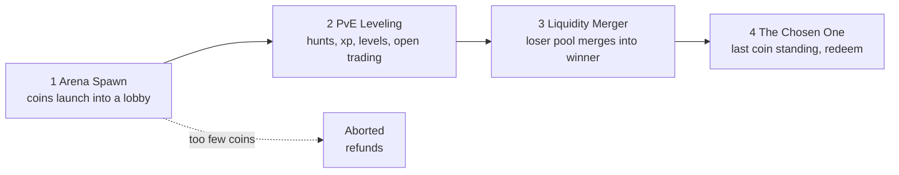
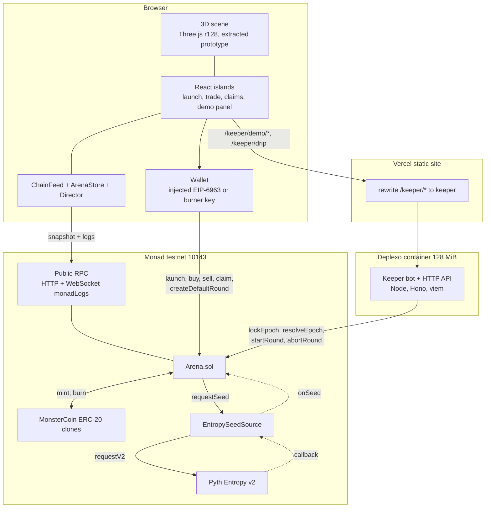
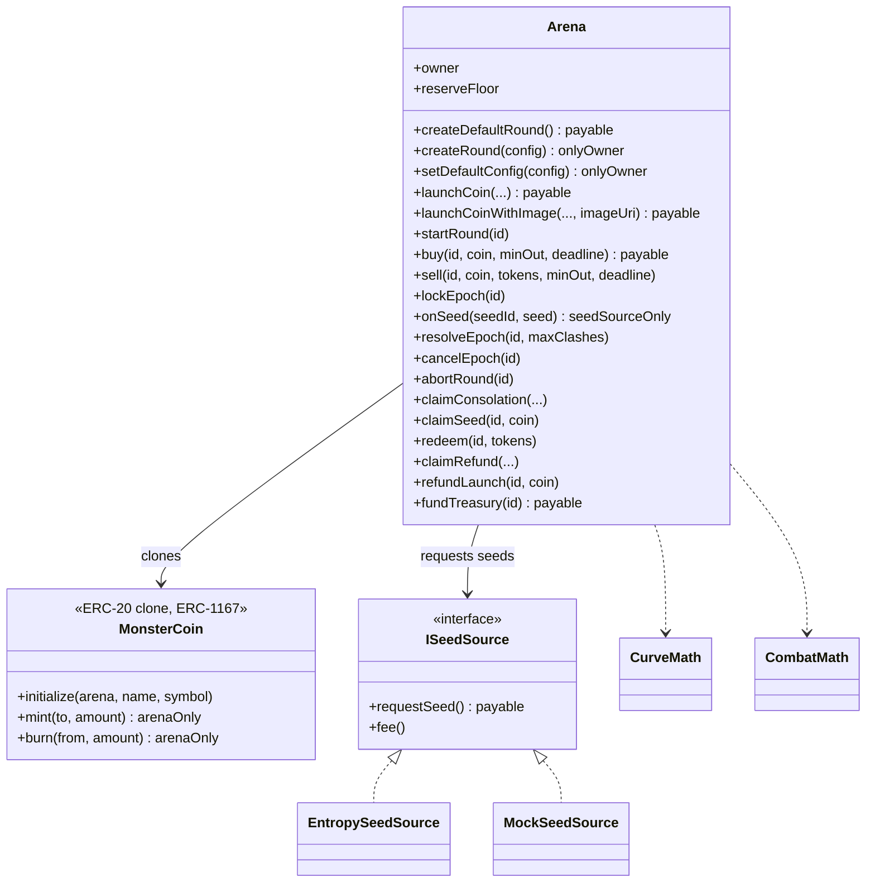
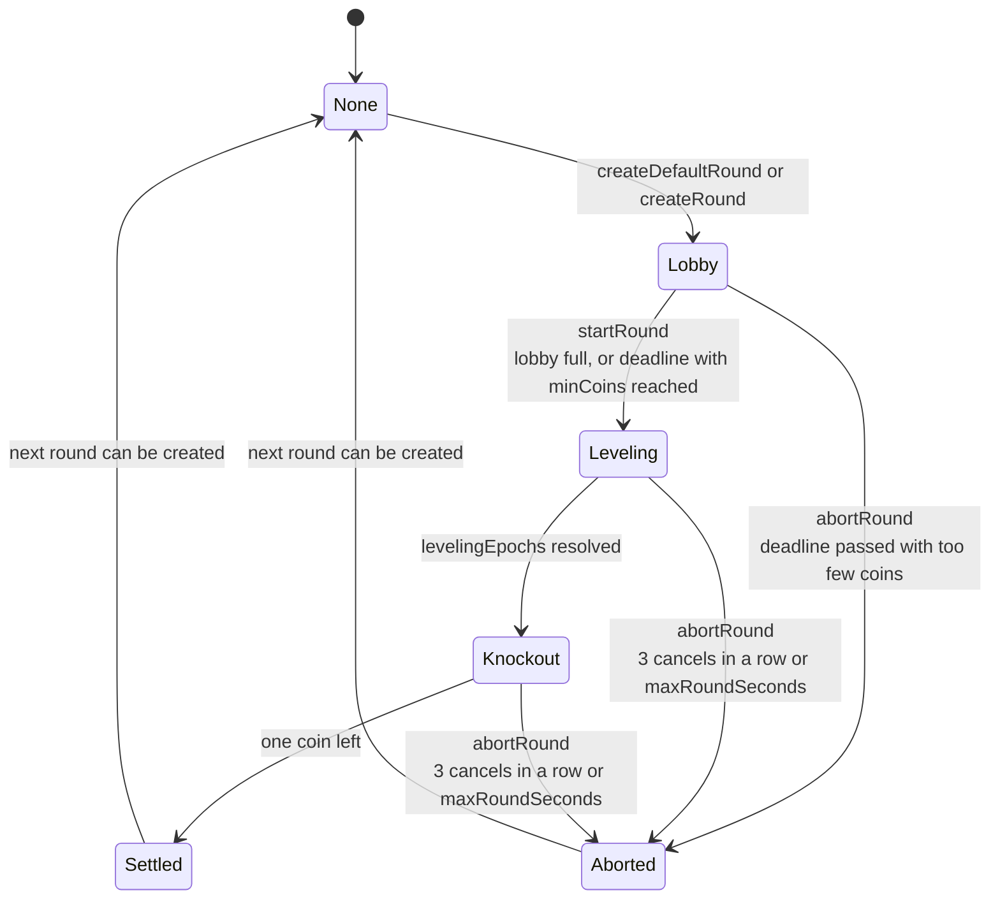
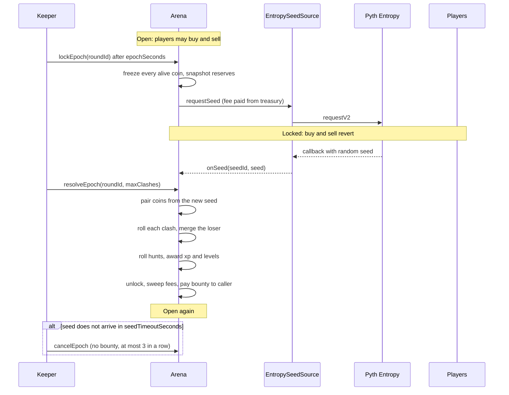
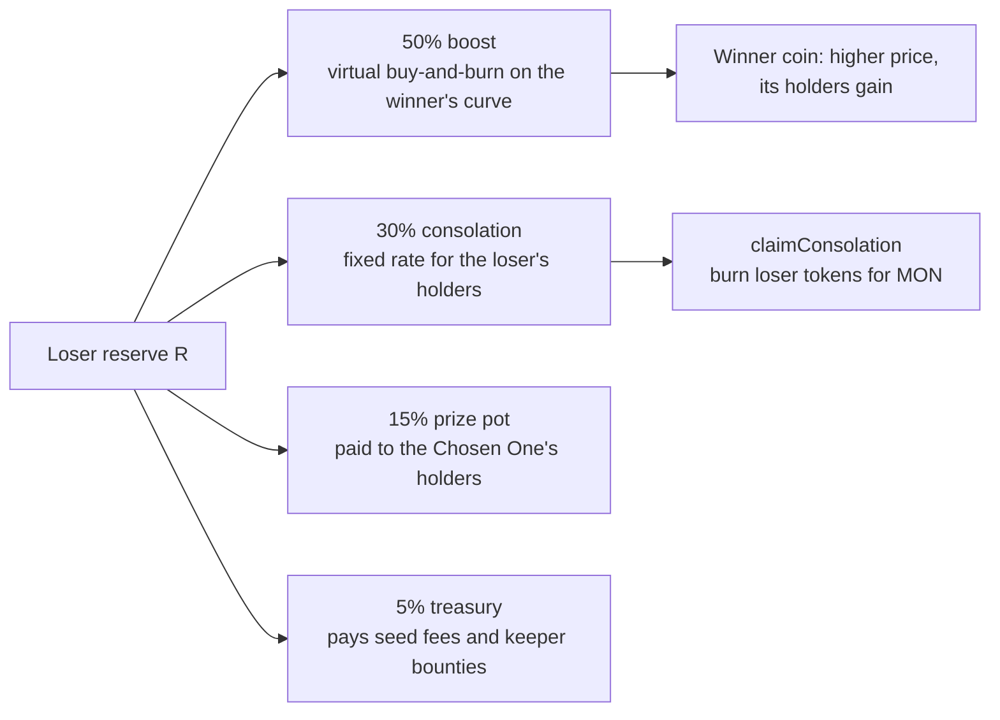
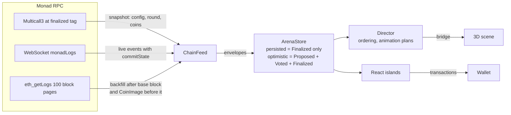
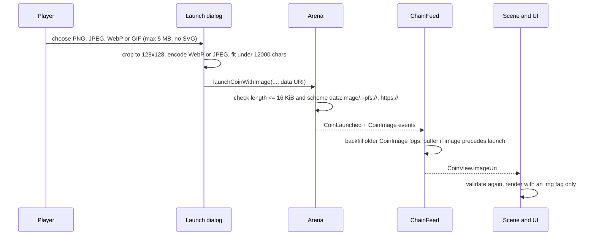
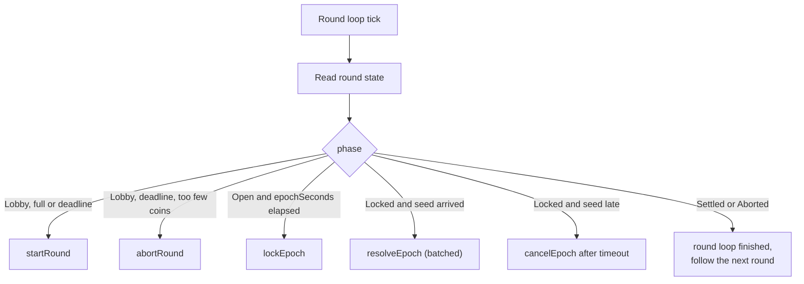
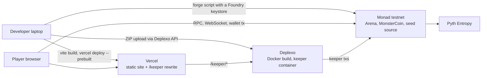

# FERA.FUN on Monad


A real-time on-chain battle royale for coins, built for fun on **Monad testnet (chain id 10143)**. Up to 30 coins live in one shared 3D arena. Every coin is a real ERC-20 with its own bonding curve, all held by one `Arena` contract. Each epoch the arena locks every coin, requests one random seed, then pairs the coins, rolls the clashes, merges each loser into its winner and runs wild-monster hunts for xp. The last coin standing is the **Chosen One** and its holders redeem the prize pool.

> **Testnet play-money.** MON on Monad testnet has no real value. Do not deposit real funds anywhere in this project. The code is not audited and nothing here is legal or financial advice.

| | |
|---|---|
| Live app | https://fera-fun.vercel.app (add `/?demo` for the demo controls) |
| Keeper API | https://fera-keeper.de.deplexo.com |
| Arena contract | [`0xb88E9941262ACE4852A5389f674Cc48558751C83`](https://testnet.monadvision.com/address/0xb88E9941262ACE4852A5389f674Cc48558751C83) |
| EntropySeedSource | [`0xa573D315d201d7BbdC405E5b26dC9eC9B6EFfF80`](https://testnet.monadvision.com/address/0xa573D315d201d7BbdC405E5b26dC9eC9B6EFfF80) |
| MonsterCoin implementation | [`0x91d9D86D133f107A4F86E7BA71BF0049E27ACF54`](https://testnet.monadvision.com/address/0x91d9D86D133f107A4F86E7BA71BF0049E27ACF54) |
| Keeper EOA | [`0xFaf5775e91d5c48f88E5312146eACb2c723288d9`](https://testnet.monadvision.com/address/0xFaf5775e91d5c48f88E5312146eACb2c723288d9) |
| Deploy block | 73723341 |
| Network | Monad testnet, chain id 10143, RPC `https://testnet-rpc.monad.xyz` |
| Mainnet (showcase) | Monad mainnet, chain id 143, Arena [`0x1457C31eb744f805E3F5a3c0a369b45397ACD975`](https://monadvision.com/address/0x1457C31eb744f805E3F5a3c0a369b45397ACD975), deployed and verified, no round open. See [Mainnet deployment](#mainnet-deployment). |

The 3D arena is the Three.js prototype (`monster_arena_3d_prototype (1).html`) extracted into a Vite app. It replays confirmed chain events and never decides an outcome. All money and all outcomes live on chain.

---

## Contents

1. [The game in four stages](#1-the-game-in-four-stages)
2. [System architecture](#2-system-architecture)
3. [Smart contracts](#3-smart-contracts)
4. [Round lifecycle](#4-round-lifecycle)
5. [One epoch, step by step](#5-one-epoch-step-by-step)
6. [Economy and mechanics](#6-economy-and-mechanics)
7. [Fairness and attack surface](#7-fairness-and-attack-surface)
8. [Client data flow](#8-client-data-flow)
9. [Token images](#9-token-images)
10. [Keeper and services](#10-keeper-and-services)
11. [Deployment topology](#11-deployment-topology)
12. [Repository layout](#12-repository-layout)
13. [Run it locally](#13-run-it-locally)
14. [Deploy it](#14-deploy-it)
15. [Demo guide](#15-demo-guide)
16. [Technology](#16-technology)
17. [What is real, what is simplified](#17-what-is-real-what-is-simplified)

---

## 1. The game in four stages

| Stage | Name | What happens |
|---|---|---|
| 1 | **Arena Spawn** | Coins are launched into a lobby. Each launch deploys an ERC-20 clone with its own pool; the creator's seed stays inside the coin until the coin ends. |
| 2 | **PvE Leveling** | Trading is open between epochs. Each epoch the arena locks, draws a seed and every coin hunts wild monsters for xp and levels. |
| 3 | **Liquidity Merger** | Knockout epochs pair coins from the fresh seed. A losing coin is merged into its winner: its reserve splits into a boost for the winner, a fixed-rate consolation for its own holders, the prize pot and the treasury. |
| 4 | **The Chosen One** | The last coin is redeem-only at `(pool + prize pot) / supply`. |



## 2. System architecture



How the pieces divide the work:

| Piece | Responsibility | Trusted for |
|---|---|---|
| `Arena` contract | holds all MON, runs the curve, the clashes, the merger, claims | everything that touches money |
| Pyth Entropy | one random seed per epoch | randomness |
| Keeper | calls the permissionless epoch functions on time, pays gas, receives a small bounty | liveness only, never fairness |
| Browser | shows state, sends the player's own transactions | nothing; it can be replaced |
| Vercel + Deplexo | hosting | availability only |

The keeper cannot change outcomes. `lockEpoch`, `resolveEpoch`, `cancelEpoch`, `startRound` and `abortRound` can be called by anyone; the keeper is just the one that calls them on time.

## 3. Smart contracts

Foundry project in `contracts/`, Solidity 0.8.31 (`evm_version = "osaka"`, no `via_ir`, no `transient` variables except through OpenZeppelin's guard), OpenZeppelin 5.6.1, Solady `FixedPointMathLib.powWad`.



Key properties of the contract surface:

- **One ledger.** Each coin's pool is a ledger entry inside `Arena`, with virtual reserves (`vMon`, `vTok`) and a real reserve (`rMon`). Tokens are real ERC-20 clones, mint and burn restricted to the Arena.
- **Permissionless rounds.** `createDefaultRound()` lets any wallet open a new lobby when no round is in progress. The round uses the config the owner stored with `setDefaultConfig`. A caller-supplied config would let an attacker set a huge `keeperBounty` and drain the treasury that carries over between rounds, so only the owner can create a custom round.
- **No owner powers over funds.** The owner sets the default config and the seed source once. There is no withdrawal path and no upgrade proxy.
- **Pull payments with explicit limits.** Every trade needs a non-zero `minOut` and a `deadline`; payouts go through one guarded helper that keeps the balance at or above `reserveFloor`.
- **Events carry the full post-state** so a client can mirror the chain from events alone (56 custom errors, 25 events).

Events: `RoundCreated`, `CoinLaunched`, `CoinImage`, `RoundStarted`, `Trade`, `EpochLocked`, `SeedReady`, `EpochResolved`, `ClashResolved`, `Boosted`, `CoinEliminated`, `ByeGranted`, `HuntResolved`, `LevelUp`, `EpochCancelled`, `RoundSettled`, `RoundAborted`, `CoinRefundRate`, `ConsolationClaimed`, `SeedClaimed`, `Redeemed`, `RefundClaimed`, `TreasuryFunded`, `TreasurySpent`, `FeesSwept`.

Tests: 127 forge tests including fuzz tests and a stateful invariant campaign (solvency `balance >= liabilities`, conservation, no stuck funds), plus named tests for the red-team cases in [section 7](#7-fairness-and-attack-surface).

## 4. Round lifecycle



- **Lobby.** Players launch coins (cap two per address). `startRound` needs the lobby full or the deadline reached with at least `minCoins`, and a treasury that covers `reserveFloor + plannedEpochs * maxEntropyFee`. If the lobby never fills, `abortRound` becomes callable and every launch can be refunded with `refundLaunch`.
- **Leveling epochs.** Hunts only: no clashes and no eliminations. Trading reopens after each resolve.
- **Knockout epochs.** Pairing and clashes. Coins left out by the per-epoch clash cap get a bye.
- **Settled / Aborted.** Claims stay open forever. A new round carries leftover treasury over to the next round.

## 5. One epoch, step by step



Why the order matters:

1. All coins are frozen **before** the seed is requested, so nobody can trade after seeing the pairing.
2. Odds are computed from numbers that were public and frozen at the lock.
3. Pairing is derived from the new seed inside the same transaction that applies the results, so the bracket cannot be known one epoch early.
4. A batched `resolveEpoch` gives identical results for any `maxClashes`, because every draw is a pure function of `(seed, aliveMask, domain tag, id)`.

## 6. Economy and mechanics

### 6.1 Bonding curve (per coin)

Constant-product curve with virtual reserves. `k = vMon * vTok` is always read from current state, never cached.

| Operation | Formula |
|---|---|
| buy `in` | `in' = in * (1 - fee)`; `out = vTok - ceil(k / (vMon + in'))`; `vMon += in'`, `vTok -= out`, `rMon += in'` |
| sell `t` | `gross = vMon - ceil(k / (vTok + t))`; `out = gross * (1 - fee)`; `vMon -= gross`, `vTok += t`, `rMon -= gross` |
| boost `X` (merger) | `k = vMon * vTok; vMon += X; rMon += X; vTok = ceil(k / vMon)` |

Rounding always favours the pool. Trade fee is 1 percent; it accrues per coin and is swept half to the prize pot and half to the treasury at resolve, so trades never write a shared hot slot.

The boost is a **virtual buy-and-burn**: it raises the price by shrinking `vTok`. A plain reserve injection would let a bot sell one wei right after a merge and take the whole bonus. With the buy-and-burn the identity holds exactly and a 1-wei seller captures about 0.000 percent of the boost.

### 6.2 Creator seed

A launch sends `launchFee + seed`. The fee goes to the treasury. The seed buys tokens held by the Arena until the coin is eliminated, the round settles or the round aborts. Seed tokens cannot be sold, and the creator takes them at a fixed rate through `claimSeed`. This blocks "ghost coins" that launch tiny, farm odds and pull the seed back.

### 6.3 Combat odds

```
power(i, j) = baseStat[type_i]
            * (1 + levelBonus * (level_i - 1))
            * elementMult(type_i, type_j)
            * clamp((rMonAtLock_i / meanRMonAlive) ^ gamma, poolFactorMin, poolFactorMax)

winProb(A) = clamp(powerA / (powerA + powerB), winProbMin, winProbMax)
roll       = uint(keccak(seed, "CLASH", clashId)) % 10000
A wins iff   roll < winProbBps(A)
```

- Five monster types: Fire Dragon, Ice Wolf, Earth Golem, Electric Fox, Dark Spirit, with an element advantage table (`elementUp` 1.15, `elementDown` 0.87).
- `gamma = 0.88`. The economy simulator found that 0.85 left the smallest pools slightly profitable and 0.88 keeps every pool size within the target return band (0.85 to 0.99 per MON staked).
- Win probability is clamped to 15 to 85 percent, so a larger pool helps without deciding the game.
- Pairing is a Fisher-Yates permutation over the alive set locked in `aliveMask`, driven by `keccak(seed, "PAIR")`. An odd coin out gets a bye. At most `clashesPerEpoch` pairs per epoch.

### 6.4 Hunts and levels

Every alive coin hunts each epoch: `uint(keccak(seed, "HUNT", coinId)) % 100 < huntWinPct` (50) gives xp, a clash win gives more. Level is a lookup on xp thresholds (1 to 10) and adds a small bonus to `power`. Hunts happen on-chain as rolls and events; monsters, positions and strike animations are replayed in the browser from those events.

### 6.5 The liquidity merger

When coin L loses to coin W, L's reserve `R` is split by basis points:



- Consolation is fixed at elimination (`consolationPool`, `consolationSupply`) and never divides by a live `totalSupply()`, so claims are order-independent and cannot be gamed.
- `consolationMode = 1` spreads the consolation share into the surviving coins' curves instead of paying holders (a config switch, off by default).
- The loser's `rMon` becomes 0 at `CoinEliminated`.

### 6.6 Settlement, aborts and claims

| Outcome | What holders do | Rate |
|---|---|---|
| Round settled | winner's holders `redeem` | `(rMon + prizePot) / supply`, fixed at settlement |
| Coin eliminated | loser's holders `claimConsolation` | fixed consolation rate |
| Creator of any coin | `claimSeed` | fixed seed rate |
| Round aborted in Lobby | `refundLaunch` | launch value back |
| Round aborted mid-round | `claimRefund` | pro-rata rate, prize pot returned inside the rates |

### 6.7 Treasury, bounty, reserve floor

- The treasury is funded by launch fees, the merger's 5 percent, swept trade fees, optional deposits through `createDefaultRound{value}` and `fundTreasury`, and any carry-over from the previous round.
- It pays the Entropy seed fee (`TreasurySpent` with kind `SeedFee`) and the keeper bounty at the end of each `resolveEpoch`.
- `reserveFloor` (constructor argument; `0` on the current testnet deploy) keeps a standing balance that payouts can never drain. A testnet check showed the Monad reserve-balance rule does not apply to contract accounts, so the floor is set to 0.

### 6.8 Presets

`createDefaultRound` uses the config stored by the owner. The testnet deployment stores the **blitz** preset, a two-minute demo round; **lite**, **demo** and **standard** are in `contracts/script/Presets.sol` and `docs/handoffs/contracts.md`.

| Parameter | blitz (deployed default) | lite | demo | standard |
|---|---|---|---|---|
| Coins max / min | 6 / 6 | 6 / 5 | 30 / 8 | 30 / 12 |
| Lobby | 600 s, starts as soon as it is full (6 coins) | 3600 s | 120 s | 900 s |
| Leveling epochs | 1 | 3 | 3 | 10 |
| Epoch spacing | 14 s | 30 s | 20 s | 60 s |
| Clashes per epoch | 2 | 3 | 6 | 4 |
| Launch fee | 0.1 MON | 0.1 MON | 1 MON | 5 MON |
| Seed range | fixed 0.1 MON | 0.2 to 5 MON | 2 to 50 MON | 10 to 500 MON |
| Keeper bounty / max Entropy fee | 0.02 / 0.2 MON | 0.02 / 0.2 MON | 0.2 / 1 MON | 1 / 10 MON |
| Merger split boost / consolation / pot / treasury | 50 / 30 / 15 / 5 | same | same | same |
| Trade fee | 1 percent | 1 percent | 1 percent | 1 percent |
| Curve | `vMon0` 20 MON, `vTok0` 1e9 tokens | same | same | same |

Every blitz coin is seeded with exactly 0.1 MON (`minSeed` equals `maxSeed`), so house coins and player coins start on the same footing and a lobby fills cheaply. A blitz round is about four epochs (one leveling, three knockout) of 14 s plus the Entropy wait of about 4 to 5 s, so each epoch takes roughly 18 to 19 s (the first leveling epoch about a second longer) and a round takes about 75 seconds from the last coin to the Chosen One. With the earlier 8 s spacing the live deployment measured 49 s and 42 s over two rounds; the 14 s figure is calculated from that, not yet measured. Seeding five house coins from the demo panel adds about 12 s. Fewer than five coins or more than `maxCoins / 2` clashes per epoch is rejected by the contract.

`docs/pitch/economy-report.md` is the simulator's verdict and the source for parameter changes. It ends in `GATE: PASS` for `gamma = 0.88` and records the findings that remain open (a small-pool premium below 0.25x of the mean pool, and the creator-seed edge at `vMon0 = 20 MON`).

## 7. Fairness and attack surface

| Risk | Mitigation | Evidence |
|---|---|---|
| Sandwiching the merger boost | boost is a virtual buy-and-burn; all alive coins are locked between the lock and the resolve | `test_T1_oneWeiSellAfterBoost` (fuzzed), simulator check |
| Ghost coins (tiny pool, farm odds, pull the seed) | creator seed is locked and not sellable; pool factor exponent below 1 and clamped | `test_T2_ghostCoinCannotUnlockSeed`, EV table 0.91 to 0.98 |
| Public bracket one epoch early | pairing derived from the new seed at resolve | `test_T4_pairingUnknowableBeforeResolve`, bye-coin edge within 5 percent |
| Trading after seeing the seed | trades revert while locked | `test_T4_noTradeWhileLocked` |
| Hostile round config draining the treasury | only the owner can supply a config; public creation uses the stored default | `PublicRound.t.sol` |
| Reentrancy on payouts | `ReentrancyGuardTransient`, checks-effects-interactions, one guarded payout helper | `Reentrancy.t.sol` |
| Insolvency | liabilities counted from counters, `balance >= liabilities` after every external call | stateful invariant campaign |
| Stuck funds | `resolveEpoch` never reverts on data; `abortRound` and refunds always exist | invariants, abort tests |
| Seed never arrives | `cancelEpoch` after `seedTimeoutSeconds`, at most 3 in a row, then `abortRound` | epoch tests |
| Keeper downtime | every epoch function is permissionless | tests, runbook |
| Malicious token images | length cap 16 KiB, scheme allow-list on chain; strict validation and `` only in the browser | `Image.t.sol`, `coinImage.test.ts` |

Known limits: randomness comes from one provider (Pyth Entropy) and its provider could re-roll; that is accepted on testnet and is a gate before any mainnet use. The code has not been audited.

## 8. Client data flow



- **Snapshot.** One Multicall3 `aggregate3` at the `finalized` tag returns the block number, timestamp, config, round and coin views. The base block is read in the same call, so state and block are atomic.
- **Live feed.** A WebSocket subscription to `monadLogs` gives each event with a `blockId` and `commitState` (`Proposed`, `Voted`, `Finalized`). Falls back to polling.
- **Backfill.** `eth_getLogs` is limited to 100 blocks per call on the public RPC, so logs are fetched in pages of 100 with at most 5 in flight. A forked block that loses to a finalized sibling is retracted.
- **Images.** `CoinImage` events can be older than the snapshot base, so they are backfilled separately from an estimated start block.
- **Two views of state.** `persisted` changes only on finalized events and drives numbers that must be right (claims, balances). `optimistic` includes unfinalized events and drives instant feedback.
- **Director.** Plays animations in event order and holds a clash until its predecessor finished; a safety timeout (15 s for a clash, 12 s for the finale) guarantees the Chosen One screen always opens. When a round changes, the scene resets and the director rehydrates.
- **Round following.** The app reads `currentRoundId()` and polls it every 3 s; a `RoundCreated` event also triggers the switch, so no redeploy is needed between rounds.
- **Commit states and UX.** A trade shows immediately as pending, clash and lock animations play once the block is voted, and claims enable when finalized (about 600 ms on Monad).

Web modes (query string):

| Query | Mode |
|---|---|
| none | live chain mode |
| `?demo` | live chain mode plus the demo controls panel |
| `?replay=fixture` (`&speed=4`) | plays `shared/fixtures/arena-replay.json`, no chain, no wallet |
| `?replay=stress&coins=30` | synthetic coins for frame-rate checks |
| `?sim=1` | the original local prototype simulation |
| `&debug=1` | shows the FPS cell |

## 9. Token images

Pump.fun style: pick an image when launching a coin and it appears on the coin's 3D label, in the leaderboard, in the inspector and on the Chosen One screen.



No server and no hosting key is needed: the image travels in the transaction and lives in the event log. A plain `launchCoin` (house coins) has no image and the UI falls back to the monster icon.

## 10. Keeper and services

The keeper (`keeper/`) is a small Node service. It bundles into one 2 MB file with esbuild and runs with a 96 MiB Node heap limit; measured under a 128 MiB container limit it used about 54 MiB right after start and stayed near 110 MiB (as reported by `docker stats`, which may include cache) over two minutes, which is why it fits Deplexo's 128 MiB free plan with little headroom.



- One transaction in flight at a time, explicit gas limits from `contracts/GAS.md` plus headroom, restart-safe (it re-reads state each tick and never double-locks).
- It follows `currentRoundId()`; when the id changes it rebinds the feed and the relay.
- Logs scrub every configured key and mnemonic.

HTTP API:

| Route | Purpose |
|---|---|
| `GET /healthz` | `{ ok, headBlock, lagSeconds, keeperAddress, roundId, round }`; 503 until a round is hydrated or when the feed lags more than 5 s |
| `POST /drip` | testnet faucet for burner wallets, rate limited per address and per IP |
| `GET /snapshot`, `GET /events`, `GET /stream` | optional relay (snapshot, buffered envelopes, SSE) |
| `GET /demo/status` | lobby state, flags `canCreate` and `canSeed`, balances |
| `POST /demo/create-round` | recycles funds of the ended round, calls `createDefaultRound` with the treasury top-up |
| `POST /demo/seed-house` | launches up to 5 house coins into the lobby |

The `/demo/*` routes exist only when `DEMO_ADMIN_TOKEN` is set, need the `x-demo-token` header (constant-time compare), are rate limited and run one operation at a time.

## 11. Deployment topology



- **Web:** a static Vite build uploaded to Vercel as prebuilt output. `/keeper/*` is rewritten to the keeper, so the browser only talks to one origin and no CORS configuration is needed.
- **Keeper:** `Dockerfile.keeper` is a two-stage build (esbuild bundle, then a slim runtime image, read-only root, non-root user) described by `deplexo.yaml`. The source goes up as a ZIP through Deplexo's API, so no Git repository access is needed.
- **Contracts:** deployed with `forge script` and a Foundry keystore; addresses are recorded in `deployments/10143.json`.
- **Secrets:** never in the repository. Keys live in `.env.local` (git-ignored) and in the hosting platforms' environment variables.
- **Limits worth knowing:** Deplexo's free plan is one app with 128 MiB RAM and 0.25 CPU, and its build queue sometimes rejects deploys with "server capacity is temporarily unavailable"; a retry works. Any 5xx from a Deplexo app is shown as an "App unavailable" page.

### Current deployment

Everything below was deployed fresh in one migration (new contracts, new keys, new hosting configuration). Only public addresses are listed.

| Piece | Where | Detail |
|---|---|---|
| Contracts | Monad testnet (10143) | Arena `0xb88E9941262ACE4852A5389f674Cc48558751C83`, EntropySeedSource `0xa573D315d201d7BbdC405E5b26dC9eC9B6EFfF80`, coin implementation `0x91d9D86D133f107A4F86E7BA71BF0049E27ACF54`, deploy block 73723341, default config **blitz** |
| Web | Vercel project `fera-fun` | https://fera-fun.vercel.app, prebuilt static output, `/keeper/*` rewritten to the keeper |
| Keeper | Deplexo app `fera-keeper` | https://fera-keeper.de.deplexo.com, `Dockerfile.keeper`, free plan (128 MiB, 0.25 CPU) |
| Entropy | Pyth on Monad testnet | contract `0x825c0390f379C631f3Cf11A82a37D20BddF93c07`, provider `0x6CC14824Ea2918f5De5C2f75A9Da968ad4BD6344` |

| Wallet | Address | Role | Funding guide |
|---|---|---|---|
| Deployer / owner | `0x331DE811fb1168A6F0AA3967591B8ecB79a30036` | deploys, owns the Arena, `setDefaultConfig` | about 1.5 MON of gas plus the 10 MON reserve floor for a deploy |
| Keeper | `0xFaf5775e91d5c48f88E5312146eACb2c723288d9` | locks, resolves and settles epochs, aborts underfilled lobbies | keep at least 10 MON (Monad reserve) plus gas |
| Drip | `0x4B8d4F8986bfCFa2D051580a15f597e08901E7F0` | faucet for visitors, `DRIP_AMOUNT_MON` each | 1 MON per visitor |
| Seeder | `0x2e31A761A02ce7D8Fb9C929C63aa6AB2693e6F7c` | creates lobbies and seeds house coins from the demo panel | about 1 MON per demo round |

The Arena holds a 10 MON reserve floor in its treasury. It carries over from round to round and cannot be taken out.

### Mainnet deployment

The same contract system is also deployed on **Monad mainnet (chain id 143)** as a showcase. Everything else in this project (keeper, web app, demo flow, tests) targets **testnet only**; nothing on mainnet is used or funded beyond the deployment itself.

| Contract | Address |
|---|---|
| Arena | [`0x1457C31eb744f805E3F5a3c0a369b45397ACD975`](https://monadvision.com/address/0x1457C31eb744f805E3F5a3c0a369b45397ACD975) |
| EntropySeedSource | [`0xa5A2c24CF63f5201C4467B01f49ADDceE6db444a`](https://monadvision.com/address/0xa5A2c24CF63f5201C4467B01f49ADDceE6db444a) |
| MonsterCoin implementation | [`0x7182918AfE574309BEB1fE48449d89d5cF285CA1`](https://monadvision.com/address/0x7182918AfE574309BEB1fE48449d89d5cF285CA1) |
| Owner | `0xe2B7f8a71d3AcAEBBe3BBEF1B5001888CA0013c0` |
| Pyth Entropy / provider | `0xD458261E832415CFd3BAE5E416FdF3230ce6F134` / `0x52DeaA1c84233F7bb8C8A45baeDE41091c616506` |
| Deploy block | 116127757 |

- All three contracts are verified on Sourcify (MonadVision); addresses are recorded in `deployments/143.json`.
- Deployed with `script/Deploy.s.sol` using `SKIP_FIRST_ROUND=true` and `MAX_ENTROPY_FEE_WEI=2000000000000000000`. The gas cost was about 1.34 MON.
- The default config is the blitz preset with the Entropy fee cap raised to 2 MON, because the mainnet Entropy fee read on chain is about 1.4 MON per request (testnet is about 0.13 MON).
- No round exists and the treasury is empty. To run it, someone would have to open a round with about 10 MON for the reserve floor and fund the treasury to roughly 18 MON before `startRound`, and run a keeper.
- The code is unaudited. Do not fund it or treat it as production.

## 12. Repository layout

```
contracts/          Foundry project: Arena, MonsterCoin, seed sources, libs, tests, deploy scripts, ABI export
  src/              Arena.sol, IArena.sol, MonsterCoin.sol, libs/, seed/
  script/           Deploy.s.sol, DeployLocal.s.sol, CreateRound.s.sol, Presets.sol, ABI scripts
  test/             unit, fuzz, invariant and red-team tests
  abi/              exported ABI JSON
  DEPLOY.md, GAS.md deploy steps with day-1 checks, measured gas limits
shared/             @animal/shared: types, ABI, ChainFeed, ArenaStore, reducer, fixtures
keeper/             keeper loop, HTTP API, demo admin, relay, drip, house seeding scripts
web/                Vite app: extracted 3D scene, React islands, director, wallet
sim/                deterministic economy simulator and its tests
deployments/        deployment descriptors per chain (public addresses only)
scripts/            dev-local.sh (anvil), dev-testnet.sh (testnet against local services)
docs/               pitch (economy report, copy), demo runbook, research, handoffs, brainstorm
Dockerfile.keeper, Dockerfile.web, deplexo.yaml   container and hosting descriptors
```

`docs/handoffs/contracts.md` is the interface contract between roles (functions, events, types, mirror rules). `docs/pitch/economy-report.md` is the economy verdict. `docs/demo/runbook.md` is the click-by-click demo path.

## 13. Run it locally

Requirements: Node 24 or newer, pnpm 11, Foundry (forge, cast, anvil), Docker only for the container builds.

```bash
pnpm install

pnpm typecheck && pnpm lint && pnpm test          # shared, keeper, web
(cd contracts && forge test --network monad)       # 127 contract tests, about two minutes
node sim/test.mjs                                  # 13 simulator tests
node sim/run.mjs --variant all --runs 4000         # EV per MON table
```

`contracts/lib` (OpenZeppelin v5.6.1, forge-std, Solady, the Pyth Entropy SDK) is git-ignored; install it with `forge install --no-git` before the first `forge build`.

### Local chain, full round on anvil

```bash
bash scripts/dev-local.sh
```

This starts `anvil --network monad`, deploys the contracts with a mock seed source, seeds house coins, runs the keeper and the web app on http://127.0.0.1:5173. A small five-coin round:

```bash
MIN_COINS=5 MAX_COINS=6 CLASHES_PER_EPOCH=3 HOUSE_COUNT=5 \
EXTRA_TREASURY=10000000000000000000 bash scripts/dev-local.sh
```

### Local services against the testnet

```bash
cp .env.example .env.local     # then fill in keys; this file is git-ignored
bash scripts/dev-testnet.sh    # keeper on :8787, web on :5173 reading deployments/10143.json
```

### Fixture replay with no chain

```bash
pnpm --filter web dev          # then open http://127.0.0.1:5173/?replay=fixture
```

## 14. Deploy it

Order matters: contracts first, then the keeper (it needs the Arena address), then the web build (it needs the Arena address, the deploy block and the keeper host).

**1. Contracts** (Foundry keystore, never a private key in the repository):

```bash
cd contracts
cast wallet import <name> --interactive            # or --private-key with --unsafe-password for a throwaway
export DEPLOYER_ACCOUNT=<name> KEEPER_ADDRESS=<keeper address> \
  ENTROPY_ADDRESS=0x825c0390f379C631f3Cf11A82a37D20BddF93c07 \
  ENTROPY_PROVIDER=0x6CC14824Ea2918f5De5C2f75A9Da968ad4BD6344
forge script script/Deploy.s.sol --rpc-url https://testnet-rpc.monad.xyz \
  --account <name> --sender <deployer address> --broadcast
```

The script deploys `MonsterCoin`, `Arena` (10 MON reserve floor by default, `RESERVE_FLOOR_WEI` overrides), `EntropySeedSource`, calls `setSeedSource` and `setDefaultConfig` (**blitz** preset), opens round 1 and writes `deployments/10143.json` and `10143.params.json`. About 1.4 MON of gas (measured) plus the floor. See `contracts/DEPLOY.md` for the day-one checks.

To change the default config of an existing Arena without redeploying, edit `Presets.sol` and run `ARENA_ADDRESS=<arena> forge script script/SetDefaultConfig.s.sol ... --broadcast`. It only affects rounds opened afterwards; an open lobby can be aborted once its `lobbySeconds` have passed.

**2. Keeper** (Deplexo API, ZIP upload, Dockerfile build). The API reference is `https://deplexo.com/user/api/v1/docs`.

```bash
# zip the files git would track (no .env, no node_modules), then upload
curl -X POST -H "Authorization: Bearer $DEPLEXO_API_KEY" -H "Content-Type: application/zip" \
  -H 'Content-Disposition: attachment; filename="source.zip"' --data-binary @source.zip \
  "https://deplexo.com/user/api/v1/sources?filename=source.zip"          # returns {"id": "<sourceId>"}

# set the environment (upsert; body is {"vars": {KEY: value}})
curl -X PUT -H "Authorization: Bearer $DEPLEXO_API_KEY" -H "Content-Type: application/json" \
  --data @env-body.json "https://deplexo.com/user/api/v1/apps/<appId>/env"

# build and start from the uploaded source
curl -X POST -H "Authorization: Bearer $DEPLEXO_API_KEY" -H "Content-Type: application/json" \
  -d '{"sourceId":"<sourceId>"}' "https://deplexo.com/user/api/v1/apps/<appId>/restart"
```

A new app is created with `POST /deploy` (`name`, `sourceId`, `dockerfilePath: "Dockerfile.keeper"`, `env`); an existing one is updated with the two calls above. The free plan allows one app. `restart` often answers `service unavailable` or the build ends `failed` with "server capacity is temporarily unavailable": repeat the call until the response carries a `deploymentId` and `GET /apps/<appId>/deployments` shows `success`. Check `https://<keeper host>/healthz` afterwards.

Keeper environment (set in the hosting dashboard or through the API, never committed): `RPC_HTTP_URL`, `RPC_WS_URL`, `ARENA_ADDRESS`, `DEPLOY_BLOCK`, `KEEPER_PRIVATE_KEY`, `DRIP_PRIVATE_KEY`, `SEEDER_PRIVATE_KEY`, `HOUSE_MNEMONIC`, `DEMO_ADMIN_TOKEN`, `ALLOWED_ORIGIN`, plus the demo tuning `DRIP_AMOUNT_MON=1`, `HOUSE_GAS_BUFFER=0.1`, `HOUSE_FLAT_SEED=1`. Leave `ROUND_ID` unset so the keeper follows the newest round, and leave `PORT` to the platform. The full list is in `.env.example` and `keeper/README.md`.

**3. Web** (static, prebuilt, Vercel):

```bash
VITE_CHAIN_ID=10143 VITE_RPC_HTTP_URL=https://testnet-rpc.monad.xyz VITE_RPC_WS_URL=wss://testnet-rpc.monad.xyz \
VITE_ARENA_ADDRESS=<arena> VITE_DEPLOY_BLOCK=<block> VITE_KEEPER_URL=/keeper VITE_DEMO_TOKEN=<same as DEMO_ADMIN_TOKEN> \
  pnpm --filter web exec vite build
mkdir -p .vercel/output/static && cp -r web/dist/. .vercel/output/static/
echo '{"version":3,"routes":[{"src":"/keeper/(.*)","dest":"https://<keeper host>/$1"},{"handle":"filesystem"},{"src":"/(.*)","dest":"/index.html"}]}' > .vercel/output/config.json
vercel link --project fera-fun --yes && vercel deploy --prebuilt --prod --yes
```

The demo token ends up in the public bundle by design; it only protects testnet funds. `shared/house-coins.json` must hold the addresses of the current house wallets (the keeper's `seed-house` script rewrites it), otherwise house coins are not labelled **House**.

**4. Smoke test.** Open `https://fera-fun.vercel.app/?demo`, press **Create Lobby**, then **Seed 5 Animals** within the 10-minute lobby window. The round should reach Settled by itself in about a minute. The same flow through the API: `POST /demo/create-round` and `POST /demo/seed-house` with the `x-demo-token` header.

**Known issues.** Deplexo shows its own "App unavailable" page for any 5xx from the keeper, so the real cause is in the runtime logs (`GET /apps/<appId>/logs/runtime`). A lobby that stays empty for `lobbySeconds` is aborted by the keeper; create a new one. The Arena treasury only grows through carry-over, so older deployments keep their floor locked.

## 15. Demo guide

1. Open https://fera-fun.vercel.app/?demo. The **Demo controls** panel appears at the bottom left and can be collapsed.
2. **Create Lobby** (enabled when there is no round, or the last round is Settled or Aborted) opens a lobby with the stored default config. Any wallet can also use the public **Start New Lobby** button.
3. **Seed 5 Animals** (enabled in a lobby with free slots) launches five house coins labelled **House**, leaving the sixth slot for you: press **Launch Coin** (name, ticker, seed 0.1 MON) and the full lobby starts by itself.
4. In demo mode (`/?demo`) a **burner wallet** connects by itself: a throwaway key kept in the browser signs every transaction, so there are no wallet popups or risk warnings, and it asks the faucet for test MON when its balance is low (the faucet gives each address 1 MON per hour). Transactions are real and on chain; only the signer differs. To use your own wallet instead, choose Disconnect in the wallet menu and connect it. Press **Launch Coin**, optionally add an image, pick a monster and skin, and confirm. A full lobby (six coins on the lite preset) starts the round at once; a lobby that reaches its deadline with at least five coins starts then.
5. Epochs run by themselves: lock, seed, resolve. Trading is open between epochs, pools move and monsters level up.
6. During the last clash between the final two coins the camera focuses on the two fighters.
7. The **Chosen One** screen shows the redeem rate and final pool. Holders redeem, holders of eliminated coins claim consolation, creators claim their seed.

The stage panel shows the round number, the stage and the time left for the current wait (lobby, next lock or resolving).

## 16. Technology

| Layer | Technology |
|---|---|
| Chain | Monad testnet (EVM, 300 ms blocks, about 600 ms finality, `monadLogs` subscription) |
| Contracts | Solidity 0.8.31, Foundry (forge, anvil, cast), OpenZeppelin 5.6.1, Solady powWad, ERC-1167 clones |
| Randomness | Pyth Entropy v2 behind an `ISeedSource` interface |
| Shared library | TypeScript 5.9, viem 2.57, zod 4 |
| Keeper | Node 24, Hono 4.13, viem, pino, esbuild bundle |
| Web | Vite, React 19 islands, Tailwind 3, three 0.128 (extracted prototype scene), viem |
| Simulator | plain Node, deterministic seeded RNG |
| Packaging | pnpm 11 workspaces, Docker multi-stage builds |
| Hosting | Vercel (static, prebuilt output with rewrite), Deplexo (container), public Monad RPC |
| Testing | forge (unit, fuzz, invariant), vitest, simulator checks |

## 17. What is real, what is simplified

- **Real:** the money (each coin's pool, the merger split, fixed-rate claims, redeem), the pairing, the clash rolls and the hunts, all from one Pyth Entropy seed per epoch, all on a public testnet.
- **Replayed:** monster movement, duel strikes and hunt fights are animations seeded by the event ids and forced to end on the chain's result.
- **Simplified:** testnet play-money; the blitz preset shortens the timers; house coins are seeded by the project and labelled **House**; the economy numbers come from a simulator and are tuned for a demo, not for mainnet.
- **Not done:** an external audit, an indexer, mainnet, and a hardened story for the demo token that ships inside the public web bundle (it only protects testnet funds).
