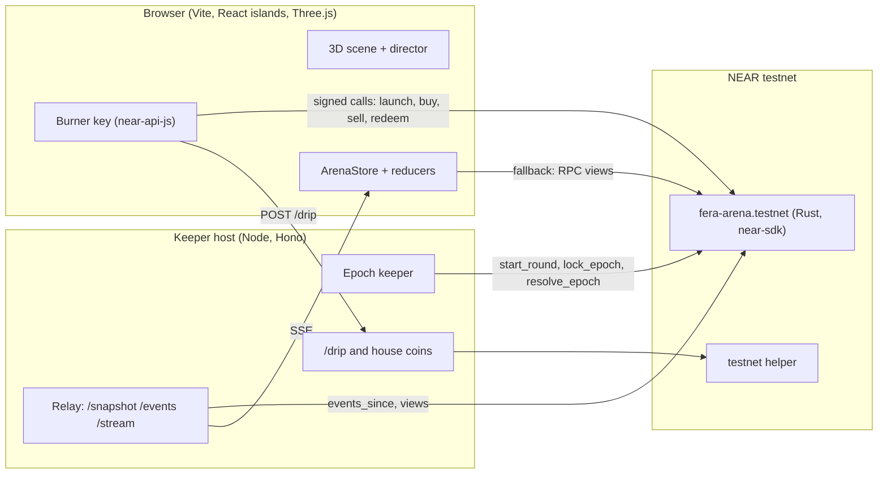
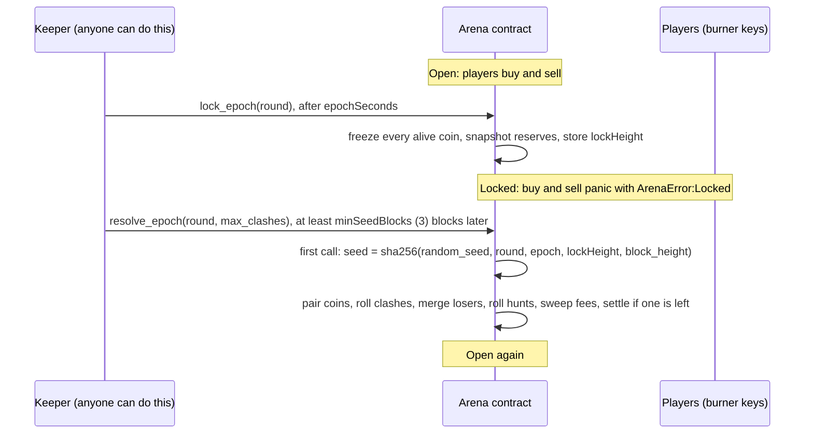

# FERA.FUN on NEAR

What if memecoin launches were a real-time battle royale? Up to 6 coins are launched into a shared 3D arena, level up by hunting, and then fight in knockout epochs until one survives. A defeated coin's liquidity is merged into its conqueror, its own holders are paid a fixed consolation rate, and the last coin is redeemable for its pool plus the prize pot. Every rule runs in one NEAR smart contract; the browser only replays confirmed on-chain events.

Built for the NEAR HACKATHON (tracks `games` and `memecoins`). This is a port: the game existed on Monad before the hackathon, and everything judged here is the NEAR integration built in the window. See [Baseline and hackathon work](#9-baseline-and-hackathon-work).

> **Testnet play-money, not audited.** NEAR on testnet has no value. Do not send real funds anywhere in this project. The contract has not been audited and nothing here is legal or financial advice.

| | |
|---|---|
| Live demo | `<<PLACEHOLDER: hosted web URL, added when hosting exists>>` (append `/?demo` for the demo controls) |
| Demo video / X post | `<<PLACEHOLDER: X post URL, published by the team lead>>` |
| Arena contract | [`fera-arena.testnet`](https://testnet.nearblocks.io/address/fera-arena.testnet) (NEAR testnet) |
| Deployment record | [`deployments/near-testnet.json`](deployments/near-testnet.json): wasm sha256, deploy and init transactions, config, gas |
| Diff of the hackathon work | [`monad-final...near`](https://github.com/Candra0x6/fera.fun/compare/monad-final...near) now; at the freeze the same diff is published as `monad-final...near-submission` |
| Monad baseline | tag `monad-final`; the Monad README is `git show monad-final:README.md` |

## Contents

1. [Try it in 60 seconds](#1-try-it-in-60-seconds)
2. [Run it yourself](#2-run-it-yourself)
3. [The game](#3-the-game)
4. [How it works on NEAR](#4-how-it-works-on-near)
5. [Fairness and trust](#5-fairness-and-trust)
6. [No admin key, Sybil and storage notes](#6-no-admin-key-sybil-and-storage-notes)
7. [Measured numbers](#7-measured-numbers)
8. [Parity with the Monad contracts](#8-parity-with-the-monad-contracts)
9. [Baseline and hackathon work](#9-baseline-and-hackathon-work)
10. [Repository layout](#10-repository-layout)
11. [Disclosures: libraries and AI-generated code](#11-disclosures-libraries-and-ai-generated-code)
12. [Known limits and what is next](#12-known-limits-and-what-is-next)

---

## 1. Try it in 60 seconds

Do X, see Y. Steps 1 to 6 need the hosted demo (`<<PLACEHOLDER: hosted web URL>>`) and the keeper that serves it; step 0 needs nothing but a checkout (see [Run it yourself](#2-run-it-yourself)).

| # | Do | See |
|---|---|---|
| 0 | Offline, no chain: `pnpm --filter web dev`, open `http://127.0.0.1:5173/?replay=fixture&speed=4` | A recorded NEAR round replays in the 3D arena at 4x speed: lobby, hunts, clashes, merger boosts, the Chosen One. The status chip reads `Replay` |
| 1 | Open `<hosted URL>/?demo` | The status chip turns live; a burner account is created in the browser and funded with 2 NEAR through the keeper's `/drip`. No wallet popup, no gas prompt |
| 2 | Click **Create Lobby** | One signed call; a toast links the transaction on `testnet.nearblocks.io` |
| 3 | Click **Seed 5 Animals**, then launch the sixth coin yourself | Five house coins are launched by the keeper's house accounts (labelled House), your coin fills the lobby and the round starts by itself |
| 4 | Watch the round; buy or sell a coin between epochs | Every 14 s or so the arena locks (trading stops), then resolves: hunts, clashes, merger boosts and eliminations animate from events read on chain |
| 5 | When one coin is left, press **Redeem** on the Chosen One screen | The pool plus prize pot is paid to your burner balance for the coins you hold |
| 6 | Read the strings on screen | Every amount says NEAR; coins are described as ledger assets of the arena |

A full 6-coin round takes well under two minutes after the lobby fills (measured numbers in [section 7](#7-measured-numbers)).

## 2. Run it yourself

Prerequisites: Node 24 or newer, pnpm 11.4.0 (see `packageManager` in `package.json`). For the contract: Rust (stable, with the `wasm32-unknown-unknown` target) and `cargo-near`. For regenerating the parity vectors only: Foundry and the Solidity libraries from the Monad baseline.

```bash
pnpm install --frozen-lockfile
pnpm --filter web dev          # http://127.0.0.1:5173, defaults to fera-arena.testnet on the public testnet RPC list
pnpm typecheck && pnpm test    # shared, keeper and web
cargo test --manifest-path contracts-near/Cargo.toml   # contract, vectors, scenario replay, 1000 random scripts
```

Web modes (query string): no parameter follows the live chain; `?demo` adds the demo controls; `?replay=fixture&speed=4` replays `shared/fixtures/arena-near-replay.json` with no chain; `?sim=1` is the original prototype simulation; `&debug=1` shows the FPS cell.

Environment variable names only (values live in your shell or host and are never committed; the full list is in [`.env.example`](.env.example)):

| Name | Used by | Meaning |
|---|---|---|
| `VITE_NEAR_NETWORK`, `VITE_ARENA_ACCOUNT`, `VITE_RPC_URLS`, `VITE_ROUND_ID` | web | network, arena account (default `fera-arena.testnet`), comma list of RPC URLs, optional pinned round |
| `VITE_KEEPER_URL` | web | keeper base URL for `/snapshot`, `/events`, `/stream` and `/drip` |
| `VITE_DEMO_TOKEN` | web | demo token for the `?demo` controls |
| `NEAR_NETWORK`, `NEAR_RPC_URLS`, `ARENA_ACCOUNT_ID` | keeper | network, RPC failover list, arena account |
| `KEEPER_ACCOUNT_ID`, `KEEPER_PRIVATE_KEY` | keeper | account that sends `start_round`, `lock_epoch`, `resolve_epoch` |
| `DRIP_ACCOUNT_ID`, `DRIP_PRIVATE_KEY`, `HELPER_URL`, `DRIP_AMOUNT_NEAR` | keeper | funding of fresh burner accounts |
| `SEEDER_ACCOUNT_ID`, `SEEDER_PRIVATE_KEY`, `HOUSE_SEED`, `DEMO_ADMIN_TOKEN`, `HOUSE_GAS_BUFFER` | keeper | demo routes and house coins |
| `ALLOWED_ORIGIN`, `PORT`, `ROUND_ID`, `CLASH_MAX_PER_RESOLVE`, `DEMO_FAST` | keeper | CORS origins, port, optional pinned round, resolve batch size, fast mode |

Running the live game against your own contract:

1. Build the contract: `cargo near build non-reproducible-wasm` inside `contracts-near/`.
2. Deploy it to an account you control and call `init` once with a config shaped like the `config` object of [`deployments/near-testnet.json`](deployments/near-testnet.json). `init` panics with `ArenaError:AlreadyInitialized` on a second call.
3. Start the keeper (`pnpm --filter keeper start`, details in [`keeper/README.md`](keeper/README.md)) with your own testnet keys, and point the web at it with `VITE_KEEPER_URL`, `VITE_ARENA_ACCOUNT` and `VITE_RPC_URLS`.

Regenerating the parity vectors: `bash near-parity/run.sh all` (needs `contracts/lib` from the Monad baseline, see [section 8](#8-parity-with-the-monad-contracts)). The committed vectors are what `cargo test` uses.

## 3. The game

| Stage | Name | What happens |
|---|---|---|
| 1 | **Arena Spawn** | Coins are launched into a lobby. A launch sends `launchFee + seed` (0.1 + 0.1 NEAR in the blitz preset). The seed stays inside the coin until it ends. |
| 2 | **PvE Leveling** | Trading is open between epochs. Each epoch the arena locks, draws a seed and every coin hunts for xp and levels. |
| 3 | **Liquidity Merger** | Knockout epochs pair coins from the fresh seed. A losing coin is merged into its winner. |
| 4 | **The Chosen One** | The last coin is redeem-only at `(pool + prize pot) / supply`. |

Game loop on paper: every **epoch (about 14 s of open trading, then a few seconds locked)** you can buy or sell any alive coin, then watch the lock, the seed and the clashes; every **round (about 75 s, four epochs in the blitz preset: one leveling, three knockout)** one coin is crowned and its holders redeem; every **session** is a sequence of rounds, each created by anyone once the previous one is settled or aborted.

### Economy and mechanics

Every coin has a constant-product curve with virtual reserves (`vMon`, `vTok`) and a real reserve `rMon`. The field names keep the Monad spelling (`monAmount`, `rMon`, `vMon`) on purpose; the unit is NEAR in yoctoNEAR.

| Operation | Formula (rounding favours the pool) |
|---|---|
| buy `in` | `net = in - ceil(in * fee)`; `out = vTok - ceil(vMon * vTok / (vMon + net))` |
| sell `t` | `gross = vMon - ceil(vMon * vTok / (vTok + t))`; `out = gross - ceil(gross * fee)` |
| boost `X` (merger) | `vMon += X`, `rMon += X`, `vTok = ceil(k / vMon)` (a virtual buy-and-burn, so a 1-wei seller right after a merge cannot capture the bonus) |

- **Combat.** `power = poolFactor * (1 + 4% * (level - 1)) * elementMultiplier`, with `poolFactor = clamp((rLock * n / sumR) ^ 0.88, 0.1, 10)`. Five monster types (Fire Dragon, Ice Wolf, Earth Golem, Electric Fox, Dark Spirit) on a cycle: the next type is 1.15x, the previous 0.87x. `winProb = clamp(powerA / (powerA + powerB), 15%, 85%)`; `A wins iff roll < winProb` with `roll = keccak(seed, "CLASH", clashId) % 10000`.
- **Hunts.** Each alive coin rolls `keccak(seed, "HUNT", coinId) % 100 < 50` every epoch: 10 xp on success, 20 xp for a clash win; levels 1 to 10 come from xp thresholds.
- **Merger split of the loser's reserve:** 50% boost to the winner's curve, 30% fixed-rate consolation for the loser's holders, 15% prize pot, 5% treasury (the treasury remainder takes the rounding).
- **Settlement.** Redeem pays `(rMon + prizePot) / supply` of the winner, fixed at settlement. Eliminated-coin holders `claim_consolation` at the rate fixed at elimination. Creators `claim_seed` at the matching rate. An underfilled lobby is aborted and each creator takes the seed and launch fee back with `refund_launch`; a stalled round is aborted after `maxRoundSeconds` and holders `claim_refund`.
- **Trade fee** 1%, accrued per coin and swept half to the prize pot and half to the treasury at resolve.
- **Preset deployed (blitz, numbers read as NEAR):** 6 coins, lobby 10,800 s (starts the moment it is full), 1 leveling epoch, epoch spacing 14 s, 2 clashes per epoch, launch fee 0.1, seed fixed at 0.1, `vMon0` 20, `vTok0` 1e9 tokens with 18 decimals.

The parameters come from the Monad economy simulator (`sim/`, report in [`docs/pitch/economy-report.md`](docs/pitch/economy-report.md), `GATE: PASS` for `gamma = 0.88`). The simulator models distributions, not this contract: it is evidence for the parameter choice, not a bit-for-bit check; parity with the contract is proved by the vectors in [section 8](#8-parity-with-the-monad-contracts).

Coins are ledger assets inside the arena contract's multi-token ledger. They are **not** NEP-141 tokens and have no per-coin contract; NEP-245 style views are not implemented yet.

## 4. How it works on NEAR



**Contract** (`contracts-near/`, Rust, near-sdk 5.30.1). One `Arena` contract holds every round, coin, curve and balance. There is no per-coin contract: balances live in an internal ledger keyed by `(round, account)` with one `u128` per coin slot. Math is in a pure `engine` module with no `near_sdk::env` access, so it runs natively under `cargo test`; `lib.rs`, `round.rs`, `claims.rs` and `store.rs` hold storage, auth, deposits and events. Payouts debit state first, then `Promise::transfer` with a callback; a failed transfer credits `claimable` and the account calls `claim_pending`. Events are emitted as NEP-297 `EVENT_JSON` logs (standard `fera_arena`) and kept in a bounded on-chain ring of 256 entries readable with `events_since(from_seq, limit)`, which the relay and the browser poll.

**Epoch cycle.**



`resolve_epoch` can be called in batches (`max_clashes`); the first call fixes the seed and the epoch stays locked until the last clash and the hunts are done. Every draw is a pure function of `(seed, alive mask, domain tag, index)`, so any batch size gives the same result. There is no cancel path: because the seed comes from the chain itself and not from an oracle, it can always be read three blocks after the lock.

**Keeper** (`keeper/`). One Node process drives `start_round`, `lock_epoch`, `resolve_epoch` and `abort_round`, and serves the read relay. It has no discretion over outcomes; every call it makes can be made by anybody, and a call someone else already made panics with a named `ArenaError:<Name>` that the keeper treats as a skip. It also serves `POST /drip` and the demo routes (`create-round`, `seed-house`), which are mounted only when their secrets are configured.

**Burner wallet and zero popups.** The browser generates an ed25519 key, the keeper funds the new account (the testnet helper first, a drip sub-account as fallback), and the page signs every call locally with `near-api-js`. A visitor never sees a wallet popup, a seed phrase or a gas prompt. The key lives in `localStorage`, which is acceptable for testnet play money only. A real wallet connection is not built: function-call keys cannot attach a deposit, so payable calls would still prompt.

**Events and the browser.** `shared/` turns on-chain events (via the relay, or via RPC views as a fallback) into the same event envelopes the Monad version used, so the 3D director and reducers are unchanged. The scene in `web/src/arena/` is untouched by the port.

## 5. Fairness and trust

| Property | How it holds |
|---|---|
| Odds are frozen before the seed exists | `lock_epoch` snapshots `rMonAtLock`, levels and the alive set; trades revert while locked. Clash odds only use those snapshotted numbers |
| The bracket cannot be known early | Pairing is derived from the new seed inside `resolve_epoch`, the same transaction that applies the results |
| The seed is not chosen by the keeper | The seed is `sha256(random_seed ‖ round ‖ epoch ‖ lockHeight ‖ block_height)`, where `random_seed` is the NEAR block randomness of the block that executes the first `resolve_epoch`, which the contract only accepts at least `minSeedBlocks` (3) blocks after `lock_epoch` |
| Draws are domain separated | Every draw is `keccak256(seed ‖ tag ‖ index)` over 96 bytes with tags `PAIR`, `CLASH`, `HUNT`, bit-identical to the Monad contract (proved by the vectors) |
| Liveness | Every lifecycle method is permissionless, so a keeper outage only delays epochs; the keeper's own gas is its only privilege |
| Solvency | Payouts are refused unless the contract balance covers its NEAR storage cost plus recorded liabilities (`ArenaError:StorageFloorBreached`); 1,000 random scripts of trades and epochs are checked for supply conservation and solvency |

**What this does not give you, stated plainly.** The seed uses NEAR's block randomness, which is produced by the validator that makes the block. A block producer who is also a player can see that block's `random_seed` before it is published and can choose not to produce the block (a validator-skip), and the party that sends the first `resolve_epoch` chooses roughly which block executes it. The `minSeedBlocks` delay means nobody can know the seed at lock time, but it does not remove that residual influence. At hackathon scale (testnet, play money) the cost of such an attack exceeds its reward and it is accepted; it is not acceptable for real value. Named upgrades, none built: commit-reveal mixed in by the keeper so a single validator cannot decide the outcome, and a verifiable randomness service for mainnet.

## 6. No admin key, Sybil and storage notes

- **No admin key in the contract.** The round config is immutable and set once in `init`; there is no owner, no `set_config`, no treasury withdrawal and no pause. Creating a round, starting it and every epoch call are open to everyone. The treasury only ever pays out through the claim paths.
- **The deployer's access key is still on the testnet account.** At the time of writing `fera-arena.testnet` still carries a full-access key (a chain query of `view_access_key_list` shows one), so the deployer could redeploy or move funds. For a mainnet deployment the contract account must have its keys deleted so that the code is locked; that has not been done and is not claimed here.
- **A test-only seed override** exists behind the cargo feature `replay` (a stored `TESTSEED` read in `resolve_epoch`). It is compiled in only by the test replay of the Solidity scenarios, is not a default feature, and is not in the deployed build (the wasm recorded in the deployment file is built without it).
- **Sybil and storage.** Each new account that buys a coin adds one ledger record of about 200 bytes; at NEAR's storage price of 1e19 yoctoNEAR per byte that is about 0.002 NEAR, which the arena pays from its own balance. The contract refuses payouts that would take its balance below `storage cost + liabilities`, and the testnet arena is funded with a reserve for that. Many cheap accounts can therefore slowly consume the reserve, and one actor with many accounts can fill a 6-coin lobby with its own coins (the cap of two coins per account is per account, not per person). Testnet account creation is free, so this is not mitigated here; a mainnet version would need an entry deposit that covers the record, or a per-person gate.
- **Demo routes spend testnet funds.** `/drip` and the house-coin routes spend testnet NEAR of the keeper's own accounts and are rate limited; the demo token in a hosted build is not a secret. None of this touches the contract.

## 7. Measured numbers

From [`deployments/near-testnet.json`](deployments/near-testnet.json) (testnet, deployed 2026-11-10 08:47 UTC at height 277044834, wasm 264,278 bytes, sha256 `cfd64765850191633d569d7332f77e56203e11f22f116ba3673eae7e82762d11`):

| Method | Prepaid gas used by the clients | Gas burnt, measured on testnet (Tgas, all receipts) |
|---|---|---|
| `create_round` | 30 | 2.76 |
| `launch_coin` | 30 | 2.74 |
| `start_round` | 30 | 2.54 |
| `buy` | 30 | 2.90 |
| `sell` | 30 | 5.70 |
| `lock_epoch` | 30 | 2.57 |
| `resolve_epoch` | 100 | 6.88 (the worst epoch of a 6-coin round: 6 alive coins, 2 clashes, 4 hunts) |
| `redeem` | 30 | 5.56 |
| `claim_seed` | 30 | 5.40 |

Epoch timings from the keeper's end-to-end run on testnet (the keeper logs `secondsLockToResolved` for every epoch): lock to resolve **4 to 7 s**, lock to the next lock **about 18 to 19 s**, and a 6-coin round **well under two minutes** from the full lobby to the settled round.

On-chain state read through the public RPC on 2026-11-10 at about 09:50 UTC (these numbers move while the keeper keeps playing): the account's code hash equals the recorded wasm hash, `current_round_id` is 5 with rounds 1 to 4 `Settled` after 4 epochs each and 5 clashes each, and the contract account held about 30.67 NEAR with 330,650 bytes of storage.

## 8. Parity with the Monad contracts

The Rust engine reproduces the Solidity libraries (`CurveMath`, `CombatMath`, including Solady's `powWad`) bit for bit, proved with golden vectors generated from the real Solidity at the `monad-final` tag with Foundry (`near-parity/`):

| File | Content | Size |
|---|---|---|
| [`near-parity/curve.json`](near-parity/curve.json) | 6,100 rows (5,000 random plus edges and composites such as zero reserves, 1 wei, `out == 0`, a `vMon * vTok` product at 2^256, buy and sell quotes, merger split, launch seed); 6,037 values and 63 expected reverts | 1.2 MB |
| [`near-parity/combat.json`](near-parity/combat.json) | 11,349 rows: `pool_factor_wad`, `power`, `win_prob_bps`, `pairing` (96-byte hash input), `clash_roll`, `hunt_roll`, `element_bps`, `level_from_xp`, with clamps, level and element matchups, zero pool, maximum pool factor, rounding boundaries; 11,341 values and 8 expected reverts | 3.0 MB |
| [`near-parity/scenario.json`](near-parity/scenario.json) | 258 steps in 6 scenarios driven through the real Solidity `Arena`: 6-coin and 5-coin rounds, a clash won by the lower-power coin, hunts and level ups, a batched resolve, a lobby abort with refunds, settle, redeem and consolation and seed claims, with the full state after every step | 1.1 MB |

- **`pool_factor_wad` is bit-exact.** [`contracts-near/tests/vectors.rs`](contracts-near/tests/vectors.rs) asserts string equality on the output of every `pool_factor_wad` row, as on every other row; `tests/replay.rs` replays all 258 scenario steps against the Solidity results; `tests/invariants.rs` runs 1,000 random scripts; `tests/scenario.rs` covers error names, the failed-payout path, aborts and the event ring.
- **Independent cross-checks inside the generators.** Every non-reverting curve row matches `shared/src/curve.ts`; pairings, clash and hunt rolls and the bye coin are recomputed from the seed with a separate keccak implementation; the combat pool factor is also compared against double-precision `Math.pow` (largest relative difference 3.7e-16). The generators fail on the first mismatch.
- Regenerate with `bash near-parity/run.sh curve|combat|scenario|all`. The scripts build under `$HOME/.cache/animal-parity-forge` and read `contracts/src` and `contracts/lib`, which is git-ignored: install it as the Monad README describes (`forge install --no-git`: OpenZeppelin v5.6.1, forge-std v1.17.0, Solady v0.1.26, Pyth Entropy SDK 2.2.1).

## 9. Baseline and hackathon work

The Monad version of FERA.FUN (Solidity contracts, keeper, 3D scene, economy simulator, testnet and a showcase mainnet deployment) existed before the hackathon and is the **baseline**. All 30 baseline commits are on the tag `monad-final` (last baseline commit `49ac30e`; the `?cam=iso` camera flag of the 3D scene was committed on `monad-archive` just before tagging, so the baseline already contains it). Nothing in `contracts/`, `sim/` or `web/src/arena/` has changed since.

Work judged here, from `git diff monad-final near` (about 150 files and 34,600 added lines before this README): [`monad-final...near`](https://github.com/Candra0x6/fera.fun/compare/monad-final...near), published as `monad-final...near-submission` at the freeze.

| New NEAR modules | What |
|---|---|
| `contracts-near/` | The Arena as a Rust near-sdk contract: engine, rounds, ledger, claims, aborts, event ring, tests |
| `near-parity/` | Foundry harnesses and generators, the three golden vector files |
| `keeper/src/nearPort.ts`, `nearTransport.ts`, `nearAccounts.ts`, `helper.ts`, `houseKeys.ts`, `rpcReads.ts`, `snapshotRefresh.ts` | NEAR keeper port, failover RPC, drip, house coins |
| `shared/src/nearFeed.ts`, `nearRpc.ts`, `nearDecode.ts`, `nearFixture.ts` | NEAR event feed and decoders, replay fixture |
| `web/src/chain/nearBurner.ts`, `nearSigner.ts`, `nearKeys.ts`, `arenaCalls.ts`, `relayFeed.ts` | Burner wallet, signing, contract calls, relay feed |
| `deployments/near-testnet.json`, `scripts/near-keeper.sh`, `vercel.json`, `Dockerfile.keeper` | Deployment record and hosting configuration (Railway keeper, Vercel web; hosting not yet live) |

Existing Monad files edited in place on this branch (for example `keeper/src/loop.ts`, `shared/src/types.ts`, `web/src/chain/*.ts`, the islands) keep their originals in the tag. The Monad Solidity contracts, tests and scripts remain in `contracts/` untouched and are not part of the NEAR runtime. The Monad contracts are on Monad testnet (chain id 10143) and, as a showcase only, on Monad mainnet (chain id 143, no round open); their addresses are in `deployments/10143.json` and `deployments/143.json`. That mainnet deployment is history, is not part of this submission and does not run the NEAR game.

## 10. Repository layout

```
contracts-near/        Rust near-sdk Arena contract and tests (new)
  src/engine/          pure curve, combat and fixed-point math (bit-exact with Solidity)
  src/lib.rs round.rs claims.rs base.rs store.rs views.rs types.rs errors.rs
  tests/               vectors, replay of scenario.json, scenario, invariants
near-parity/           golden vectors and their generators (new)
  curve.json combat.json scenario.json, gen/ (TypeScript), forge/ (Foundry harnesses), run.sh
keeper/                Node keeper, relay, drip and demo routes (NEAR port of the Monad keeper)
shared/                event types, reducers, NEAR feed and RPC, replay fixtures
web/                   Vite + React islands + Three.js arena; src/chain is the NEAR layer
deployments/           near-testnet.json (new); 10143, 143, 31337 are Monad records
scripts/               near-keeper.sh runs the keeper from keys kept outside the repo
contracts/             Monad Solidity baseline, unchanged (also the source of the parity vectors)
sim/                   Monad economy simulator, unchanged
docs/pitch/            economy report, product copy, and the hackathon submission drafts
docs/research/near/    short research notes written during the port
```

## 11. Disclosures: libraries and AI-generated code

**AI-generated code.** The code in this repository was written by AI coding agents (Claude Code, Anthropic Claude models), working to written role briefs and run by the team lead, in both the Monad baseline and the NEAR work. The commits are authored under the lead's git identity and carry no AI trailer, so this section is the record. For the hackathon window (`git diff monad-final near`, about 150 files), the AI-written files are:

| Path | Files | Notes |
|---|---|---|
| `contracts-near/**` | 21 | whole contract, engine, tests (Cargo.lock generated by cargo) |
| `near-parity/**` | 15 | harnesses, generators, run script; the three vector files are generator output |
| `keeper/**` | 44 (17 new, 27 edited) | NEAR port, drip, house coins, relay refresh, Railway config, tests |
| `shared/**` | 24 (11 new, 13 edited) | NEAR feed, RPC client, decoders, fixture generator and tests |
| `web/**` | 40 (8 new, 32 edited) | burner wallet, signing, contract calls, relay feed, island and copy edits, tests |
| `deployments/near-testnet.json`, `scripts/near-keeper.sh`, `vercel.json`, `Dockerfile.keeper`, `.env.example`, `pnpm-lock.yaml` | 6 | config; the lockfile is generated by pnpm |
| `docs/research/near/**` (2), `README.md`, `docs/pitch/near-submission.md` | 4 | research notes and the submission texts |

Not changed in the window: `contracts/**` (Solidity baseline), `sim/**`, `web/src/arena/**` (the 3D scene extracted from a pre-existing Three.js prototype). The Monad baseline files were also produced with agents; the Monad role briefs are in `docs/handoffs/`.

**Libraries and boilerplate** (all open source, none vendored except as noted): Rust `near-sdk` 5.30.1 and `uint` 0.10.2 (256-bit integers); TypeScript `near-api-js` 7.4.0, `react` and `react-dom` 19.3.1, `three` 0.128.0, `hono` 4.13.13 with `@hono/node-server` 2.1.5, `pino` 10.4.0, `zod` 4.6.7, `viem` 2.57.7 (keccak and ABI helpers, also used by the parity generators), `vite` 8.3.4, `tailwindcss` 3.4.19, `typescript` 5.9.3, `vitest` 5.0.5, `tsx` 4.23.15, `eslint` 10.13.0. Baseline Solidity libraries (used by the Monad contracts and by the vector generators): OpenZeppelin Contracts v5.6.1, forge-std v1.17.0, Solady v0.1.26 and the Pyth Entropy SDK 2.2.1 (git-ignored, installed locally). No project template or boilerplate repository was used; the 3D scene comes from the project's own earlier Three.js prototype.

## 12. Known limits and what is next

- Testnet only; no mainnet NEAR deployment; not audited; the deployer key is still on the testnet account (section 6).
- Randomness is block randomness with the residual validator influence described in section 5; commit-reveal is the named upgrade.
- Coins are ledger assets, not NEP-141 tokens; NEP-245 views and transfers are not implemented, which matters for the `memecoins` track.
- Burner key wallet only; real wallet connection and an internal play balance are not built.
- Sybil resistance and per-account storage cost are not handled (section 6).
- Coin images, a `consolationMode` switch and keeper bounties from the Monad version are not part of the NEAR contract.
- Hosting (keeper and web) and the demo video are pending; the live URL and X post above are placeholders until they exist.
