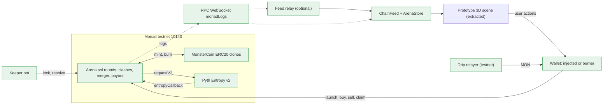

# Monster Arena on Monad: onchain architecture plan

- **Date**: 2026-10-19 · **Project**: ANIMAL / Monster Arena (`/home/cn/Projects/Competition/Web3/ANIMAL`) · **Mode**: Smart contract / web3 + Feature build (whole-product onchain plan)
- **Status**: draft (decisions unconfirmed). Written by a brainstorm sub-agent that could not ask the user. Every "default" below is my recommendation, not a confirmed choice. The builder (or hackathon-pm) must put the **Open questions** to Candra first, in particular Q0 to Q3.
- **Companion files**: [architecture](./2026-10-19-monad-monster-arena-onchain/architecture.md) · [research](./2026-10-19-monad-monster-arena-onchain/research.md)
- **First real `docs/arch.md`**: [../arch.md](../arch.md) (short summary and pointers to this plan)

## Context

What exists (all facts read on 2026-10-19):

- `docs/download (1).png`: the 4-stage diagram. (1) Arena Spawn: 0/30 coins on a live map, each with its own liquidity pool. (2) PvE Leveling: coins defeat monsters and have rapid clashes. (3) Liquidity Merger: a coin that loses a clash has its liquidity merged: "Auto-Buy Boosts Winner" and "Value Redistributed to Losers". (4) The Chosen One: last coin standing wins the big pool.
- `monster_arena_3d_prototype (1).html` (4,184 lines, single file, Three.js r128 and Tailwind from CDNs): a fully client-side simulation. It is the **main frontend to keep**. 5 monster archetypes, 5 skins, 4 biomes, 12 fake `INITIAL_TOKENS` with simulated-USD `lp`, random encounters and random-damage duels. Two facts that matter for the chain design: the winner of a duel is random (`Math.random()` damage), and `lp` is **never transferred** on a win, so the liquidity merger does not exist in the prototype at all. Full `file:line` map in the companion `architecture.md`.
- `docs/arch.md`: was empty. Now a summary page.
- No git repo, no `package.json`, no contracts, no tests. Hardhat/Foundry, Next.js, a keeper and an indexer all have to be created.
- Candra's machine: Arch Linux, 14 GB RAM, `npm`/`pnpm`/`cargo` already shimmed to 4 cores; Foundry is not confirmed installed.

The constraint that shaped the decision: the product is "coins fight and absorb each other's liquidity", which is a money-moving, randomness-dependent game on a chain with **no global mempool and leader-ordered blocks** (research R7), so the design cannot rely on hiding transactions. It has to be safe because nothing exploitable is tradable at the moment information appears.

## The question

How should this be built on Monad: which contracts, how 30 coins spawn, what "level" and "PvE" mean onchain versus offchain, how clash winners are decided fairly, how the liquidity merger (auto-buy plus redistribution) works without being sandwiched or gamed, how events reach the existing 3D scene in near real time, and what is the minimum slice that is realistic for a hackathon.

## Decision

**Recommended: Option A, an on-chain Arena with a ledger-in-Arena bonding curve per coin, a global epoch lock, and one Pyth Entropy seed per epoch**, deployed on Monad **testnet (10143)** as play-money, with the unmodified 3D prototype driven by a direct `monadLogs` WebSocket feed. It beats the alternatives because it is the only one that is both fair (outcomes from a provider seed that does not exist until every coin is frozen) and faithful to the diagram (each coin really owns a pool; the loser's pool really moves).

Locked-in-the-plan decisions (all still **draft** until the user confirms; see Open questions):

1. All MON for all coins lives in one `Arena` contract in a per-coin ledger; each coin is also a real ERC-20 clone (`MonsterCoin`) whose mint and burn only the Arena can do. No transfer-restriction hooks, no `permit`, no user-callable burn.
2. Each coin has its own pump.fun-style virtual-reserve constant-product curve (`vMon`, `vTok`, real backing `rMon`). `k = vMon * vTok` is always read from current state, never cached.
3. Rounds have up to 30 coins and four phases: Lobby, Leveling, Knockout, Settled (plus Aborted). The creator's seed buy is **permanent** (held by the Arena until the coin is eliminated, the round settles or aborts), so a launched coin always has real stake in it.
4. Every epoch: `lockEpoch()` freezes trading on **all** alive coins and requests an Entropy seed; the callback stores the seed only; `resolveEpoch()` pairs the coins from the new seed, rolls each clash, merges, runs PvE hunts, unlocks. Trading is paused only for about the Entropy latency (2-4 s) plus a block or two.
5. Clash odds are public and frozen before the seed exists: `power = base x level x element x pool factor`, `winProb = powA / (powA + powB)` clamped to 15-85 %. The roll is `keccak(seed, "CLASH", clashId) % 10000`. Every draw is domain-tagged.
6. The merger moves the loser's real reserve `R` in basis points: **50 % boost** (winner's curve does a virtual buy-and-burn: `vMon += X`, `rMon += X`, `vTok = ceil(k / vMon)`), **30 % consolation** (loser holders burn tokens at a fixed rate), **15 % prize pot**, **5 % treasury** (Entropy fees and keeper bounty). These numbers are tunable assumptions (Open question 1).
7. The Chosen One coin becomes redeem-only: holders burn tokens for `(rMon + pot) / supply` each. No curve exit, no race to exit.
8. PvE onchain means only what changes money: per-epoch hunt rolls produce XP, XP produces a level, level gives a small power bonus. The monsters you fight, positions, animation and strike-by-strike HP are offchain and cosmetic, replayed deterministically from the events.
9. Event stream to the client: direct WebSocket `monadLogs` subscription (via a keyed provider and an optional relay), Multicall3 snapshot on load, animations gated on `commitState` (Proposed = optimistic text only, Voted = play, Finalized = persist and enable claims). No indexer in the hot path; Envio is P2 for history.
10. Wallet P0: plain EOA (injected wallet via EIP-6963, plus an in-browser testnet burner key with a faucet drip). No EIP-7702, no session keys, no sponsored gas in P0 (reserve-balance rule, research R8). Privy is P1.
11. Do **not** build on nad.fun or an external AMM: the Arena must lock a coin, drain the loser and inject into the winner atomically (research R31).

## Options considered

**A. On-chain Arena, ledger-in-Arena curve, global lock, Entropy seed per epoch (recommended).** Everything that moves money is on chain and trust-minimised; the cost is real contract surface (curve + epoch engine + settlement) and a keeper.

**B. Hybrid: on-chain pools, but clash results signed by a keeper (EIP-712) and verified by the contract.** Roughly 40 % less contract work and instant results, and it reuses the prototype's own random duels almost directly. But "fair" collapses to "trust the operator", which is the first thing a judge will probe. Keep as an emergency fallback only for the randomness piece (the `ISeedSource` interface makes that a swap, not a redesign).

**C. Deterministic combat from onchain stats, no randomness.** Cheapest and fully transparent, but outcomes are predictable the moment stats are public (bots front-run, no drama, the biggest pool always wins). Useful as the balance-testing baseline and as the offline mode of the econ simulator.

**D. Wrap existing nad.fun tokens.** Rejected. nad.fun's curve cannot be paused per coin, drained or injected by a third-party contract, third-party-contract use is undocumented, creating a coin costs 10 MON and graduation 1,000 MON (R30, R31). Its anti-sniping decay and Hypeboard buyback are good prior art to borrow ideas from.

**E. Contrarian: no tradable coins, stake pools only (shares, no ERC-20, no curve).** Each coin has a stake pool, the epoch engine and merger are identical, the client is identical. It deletes the curve math and most abuse surface and halves the contract work, but loses the "coin" identity (price chart, wallet tokens). **This is the gated fallback track**: switch if curve and merger tests are not green by the gate in the plan.

| | Impact | Effort in this repo | Risk | Fit with prototype and diagram | Reversibility | Scale-ready (MVP tier) |
|---|---|---|---|---|---|---|
| A. Arena + curve + lock + Entropy | high | high (about 72 agent-hours P0) | medium (money contract) | high | medium (redeploy per round) | OK |
| B. Keeper-signed results | medium | medium | high (trust) | high | high | OK |
| C. Deterministic | low | low | high (predictable, front-run) | medium | high | OK |
| D. Wrap nad.fun | medium | medium | high (cannot do the merger) | low | high | n/a |
| E. Stake pools only | medium | low-medium | low | medium (no coin) | high | OK |

**Recommendation and the condition that would change it.** Option A, because fairness and "the loser's pool really moves" are the whole pitch and both need contract control of the pools. I would switch to E if the curve/merger invariant tests are still red at hour 16 of the gate, or to B-for-randomness only if Entropy mainnet latency or fee makes epochs unusable.

**Pre-mortem** (it is three months later and this failed, why):

1. The economy was degenerate: ghost coins or whales farmed it. My sim and the red-team sim both show the first version of the pool factor rewards tiny pools; fixed with the permanent seed and a flatter pool exponent (see Economy). The simulator becomes an acceptance gate.
2. The curve boost was implemented as a plain reserve injection and a bot drained it with 1-wei sells. Fixed in the spec (virtual buy-and-burn plus a named test).
3. Demo stalled: Entropy late, keeper dead, or the public RPC rate-limited the 3D client. Fixed with `cancelEpoch`, `abortRound`, a keyed provider and relay, and a documented fallback.
4. The 3D client disagreed with the chain (duels showed the wrong winner). Fixed by making the duel a pure replay of `ClashResolved`, never computed from HP.
5. Legal or judge pushback on a pool-pays-holders game. Fixed by testnet, play-money framing, and labelling house-seeded coins.
6. Scope blew up (indexer, Privy, 7702, NFTs). Fixed by the P0/P1/P2 split and the Blitz cut.

### Reconciliation with `docs/handoffs/` (written in parallel by hackathon-pm)

While I was writing, `hackathon-pm` produced its own contract handoff (`docs/handoffs/contracts.md`, `01-smart-contracts.md`; its `STATUS.md` says "if the brainstorm plan appears later and differs, reconcile before dispatch"). I read its contract spec only by targeted search, not in full, so treat the table as a pointer for the PM, not a review. Where the two plans differ:

| Topic | PM handoff (as found) | This plan | Recommendation |
|---|---|---|---|
| Randomness P0 | `BlockhashSeed`: `keccak(blockhash(startBlock + 2), ...)`; `EntropySeed` is P1 | Pyth Entropy per epoch is P0 behind `ISeedSource`; Mock on anvil; blockhash never used for value | Blockhash is leader-influenceable and has a 256-block (about 77 s) window (R9, R10, R21). Acceptable only as a **disclosed demo-grade fallback for a one-day cut**. For the main build, make Entropy P0: it is about 3h of adapter work plus 2h to verify on testnet. |
| Pairing | `startClash(a, b)` is keeper or owner only, so a trusted party chooses pairs | Pairing is derived from the new seed inside `resolveEpoch`; nobody chooses | A keeper that picks pairs can cherry-pick matchups and leak the bracket (red-team F4). Keep seed-derived pairing. |
| Freeze | Per-clash freeze: only the two coins in a clash are locked, others keep trading | Global epoch lock for all alive coins for about 3-5 s per epoch | Per-clash freeze is better UX but leaves pairing and outcome knowable while the other 28 coins trade, and the pair is known before the lock. Keep the global lock; tune `epochSeconds` so the paused share is under 25 %. |
| Odds weight | `isqrt(reserve) x (100 + 10 x level) x element` (square-root pool factor) | `(rMon / mean)^0.85` clamped, level 4 %/level, element 1.15/0.87 | The square-root factor is exactly the "first design" in the Economy table (EV per MON about 4x for a coin at 0.1x pool, about 0.59 at 5x). Use gamma about 0.85 or re-run the sim and accept the result consciously. |
| Creator seed | Seed becomes `reserveMon`, whole supply minted into the pool, creator holds no tokens (so the seed is already permanent) | Seed buys tokens held by the Arena until elimination or end; creator can reclaim afterwards | Equivalent on the ghost problem; the PM's version is simpler. Either is fine as long as the creator cannot withdraw the seed mid-round. The small-pool EV premium still needs the flatter exponent. |
| Merger split | boost 70 % / holders 20 % / fee 10 % (fee to prize pool); real buy-and-burn of the winner token | 50 / 30 / 15 / 5 with virtual buy-and-burn | Numbers are a product decision (Q1, Q10), tune with the sim. The buy-and-burn approach matches (it avoids the F1 bearer-bonus bug as long as the burn removes tokens from the curve side). |
| Symbols | unique on chain | not unique | Unique symbols can be squatted by front-running the launch (F7); minor on testnet. Either choice is acceptable; the UI must still escape text. |
| PvE | keeper-only `runPvE`, seeded from `blockhash` | per-epoch hunts from the same Entropy seed, inside `resolveEpoch` | Keeper-only PvE with blockhash lets the keeper choose when to run it. Prefer in-epoch hunts, or keep P1. |
| Clash pacing | time or block based, up to `MAX_CONCURRENT_CLASHES` 2, keeper picks | epoch based, up to `clashesPerEpoch` pairs resolved in one tx | Epoch batching is what lets one Entropy request serve many clashes. |

Net: the PM's plan is a good, simpler scaffold for the **Blitz cut** if its trust shortcuts are labelled in the UI ("demo seed: blockhash, keeper-paired"). For the main build, take this plan's randomness, pairing and lock, and keep the PM's file layout, deployment descriptors and fixtures. This becomes Open question Q13.

## Spec

### 0. Proposed architecture (copied from `architecture.md`)


_Caption: green = new. The 3D scene is the only existing box. Scale tier: MVP (pre-launch hackathon, tens of spectators, one active round); the binding limits are public RPC rate limits and the 30M per-tx gas cap, not user count. The epoch sequence, the clash decision flow, the merger flow, the ER model and both lifecycles are in `architecture.md`._

### 1. Contracts (Foundry project, `contracts/`)

Toolchain: stock Foundry 1.8+ with `network = "monad"` in `foundry.toml`; Solidity 0.8.31 with `evm_version = "osaka"` (verify with `forge build` and a testnet deploy, research R6). Libraries: OpenZeppelin Contracts (ERC-20 without Burnable or Permit, `Clones`, `ReentrancyGuardTransient`), Solady `FixedPointMathLib.powWad` for the fractional pool exponent. Pin versions.

| File | Purpose |
|---|---|
| `Arena.sol` | Rounds, lobby, curve ledger, buy/sell, epoch lock/resolve/cancel, clashes, hunts, merger, settlement, claims, abort, treasury. |
| `MonsterCoin.sol` | ERC-20 clone shell: `initialize(arena, name, symbol)`, `mint`/`burn` only by Arena. `_disableInitializers()` on the implementation; initialise in the same tx as the clone (R33). |
| `libs/CurveMath.sol` | Buy/sell quotes with ceil rounding in the pool's favour (R32). |
| `libs/CombatMath.sol` | Power, win probability, level from xp, hunt roll. Pure functions, fuzzable. |
| `seed/ISeedSource.sol`, `EntropySeedSource.sol`, `MockSeedSource.sol` | `requestSeed() payable returns (uint64 id)`, `fee() view`. Arena exposes `onSeed(id, seed)` callable only by the source. Entropy wrapper implements Pyth's consumer interface; Mock is for anvil and tests; a demo-only hash-chain source stays disabled by default. |
| `shared/catalog.json` | monsterId string, enum index, element, `baseStat`, skin index. Read by tests, keeper and client. |

**Money model (invariants to test, in this order of importance):**

1. `address(this).balance >= totalLiabilities` after every external call, where liabilities = sum of coin `rMon` + prize pot + unclaimed consolation pools + redeem pool + treasury + refunds owed. Use counters, never `balance ==` (force-sent MON must not break anything).
2. Curve solvency: for every sequence of buy, sell and boost, selling all circulating supply never needs more than `rMon`. Boost is `vMon += X; rMon += X; vTok = ceil(k / vMon)` with `k` taken from current state before the boost. **Named test:** after a boost, `sell(1 wei)` pays about `price x 1 wei`, not the boost. (Red-team finding F1: injecting MON without shrinking `vTok` pays the whole bonus to the first seller.)
3. Claim rates are fixed once: `consolationPool`/`consolationSupply` at elimination and `redeemPool`/`redeemSupply` at settlement; payout is `floor(amount x pool / supply)` per burn; never divide by a live `totalSupply()`. Sum of payouts at most the pool; dust at most 1 wei per claim.
4. Stranded surplus after the boost (the curve cannot pay it out through sells) is recovered by the settlement or elimination redemption. It is never withdrawable by an owner. There is no owner withdrawal path at all.
5. No funds can be stuck: `resolveEpoch` never reverts on data (zero supply, zero reserve are guarded), and `abortRound` exists.

**Curve (sketch of the shape, parameters are tunable):**

```text
// SKETCH ONLY, not an implementation
state per coin: vMon (virtual+real MON), vTok (virtual token reserve), rMon (real backing), supply
init:           vMon0 = 20 MON, vTok0 = 1_000_000_000e18   (spot price0 = vMon/vTok)
buy(in):        in' = in*(1-fee); out = vTok - ceil(k/(vMon+in')); vMon += in'; vTok -= out; rMon += in'
sell(t):        gross = vMon - ceil(k/(vTok+t)); out = gross*(1-fee); vMon -= gross; vTok += t; rMon -= gross
boost(X):       k = vMon*vTok; vMon += X; rMon += X; vTok = ceil(k/vMon)      // virtual buy and burn
fee:            100 bps, ceil rounded; per-coin accrual, swept to pot/treasury at resolve or settle (no shared hot slot on trade)
every trade:    mandatory minOut and deadline; nonReentrant (TSTORE guard); checks-effects-interactions on MON sends
```

**Combat (sketch of the shape):**

```text
// SKETCH ONLY
power(i, j)  = baseStat[type_i] * (1 + levelBonus * (level_i - 1))
               * elementMult(type_i, type_j)                       // 1.15 if i beats j, 0.87 if j beats i, else 1.0
               * clamp( (rMonAtLock_i / meanRMonAlive) ^ gamma, 0.1, 10 )   // gamma = 0.85, via powWad
winProbBps(A) = clamp( powA / (powA + powB), 1500, 8500 )
roll          = uint(keccak(seed_n, "CLASH", clashId)) % 10000;  A wins iff roll < winProbBps(A)
pairing       = Fisher-Yates over alive coins with keccak(seed_n, "PAIR"); odd coin out gets a bye; at most clashesPerEpoch pairs
hunt (each alive coin, each epoch) = uint(keccak(seed_n, "HUNT", coinId)) % 100 < huntWinPct; success gives xp, clash win gives more xp
level         = lookup on xp thresholds (1..10)
element cycle (flavour, tunable): fire > ice > earth > electric > dark > fire
```

Why this is fair, in plain terms: (a) the odds depend only on public, frozen inputs; (b) the random number is produced by an external provider after the coins are frozen and no coin can trade between the freeze and the resolution, so there is nothing to act on; (c) the pairing is derived from the same new seed in the same transaction that applies the result, so there is no "public bracket" window; (d) the pool factor is flattened (gamma 0.85) so that expected return per MON is roughly the same for small and large pools (Economy table), which removes the incentive to ghost or to whale.

**Round config (immutable per round; two presets, all numbers are assumptions to tune with the sim):**

| Parameter | demo | standard |
|---|---|---|
| `maxCoins` / `minCoins` | 30 / 8 | 30 / 12 |
| `lobbySeconds` | 120 | 900 |
| `levelingEpochs` | 3 | 10 |
| `epochSeconds` (min spacing between locks) | 20 | 60 |
| `clashesPerEpoch` (cap) | 6 | 4 |
| `seedTimeoutSeconds` (before `cancelEpoch`) | 60 | 60 |
| `maxRoundSeconds` (then `abortRound` is open) | 3,600 | 86,400 |
| `launchFee` / `minSeed` / `maxSeed` (testnet MON) | 1 / 2 / 50 | 5 / 10 / 500 |
| `tradeFeeBps` | 100 | 100 |
| `mergeBps` boost / consolation / pot / treasury | 5000 / 3000 / 1500 / 500 | same |
| `gammaBps`, pool factor clamp | 8500, 0.1-10 | same |
| `levelBonusBps`, element up/down bps | 400, 11500/8700 | same |
| `winProbMinBps` / `winProbMaxBps` | 1500 / 8500 | same |
| `keeperBounty` (paid at resolve only, capped by treasury) | 0.2 MON | 1 MON |

Demo round length: 3 leveling epochs of 20 s, then roughly 7 knockout epochs (30 to 24 to 18 to 12 to 6 to 3 to 2 to 1 with 6 clashes per epoch), so about 3.5 minutes. Entropy cost per demo round is about 10 requests: about 1.3 MON on testnet (`getFeeV2` about 0.128), about 14 MON on mainnet (about 1.4 MON each, 10 MON worst case, R15).

**External interface (sketch; names are binding for the client and keeper):**

```text
// SKETCH ONLY. Callers: P = player, K = keeper (anyone may call), S = seed source
createRound(config)                                  // owner, between rounds only; no withdrawal powers
launchCoin(name, ticker[A-Z0-9]{2,7}, monsterType, skinId) payable   // P, Lobby; msg.value = launchFee + seed; per-address cap 2
refundLaunch(roundId, coinId)                         // P, only if round Aborted in Lobby
startRound(roundId)                                   // K, when 30 coins or deadline and >= minCoins and treasury covers all epochs; bounty
buy(roundId, coinId, minTokensOut, deadline) payable  // P, only when round not locked
sell(roundId, coinId, tokens, minMonOut, deadline)    // P, only when round not locked; creator seed tokens are not sellable
lockEpoch(roundId)                                    // K, timer-gated; requests the seed; sets round locked
onSeed(seedId, seed)                                  // S only; stores the seed and emits; nothing else
resolveEpoch(roundId, maxClashes)                     // K, after seed; pairs, rolls, merges, hunts, unlocks; bounty; batchable
cancelEpoch(roundId)                                  // K, only after seedTimeout AND only while no seed has arrived; no bounty; cap 3 in a row
abortRound(roundId)                                   // anyone, after 3 cancels in a row or maxRoundSeconds; pro-rata refunds
claimConsolation(roundId, coinId, tokens)             // holder of an eliminated coin burns tokens for MON
redeem(roundId, tokens)                               // holder of the Chosen One burns tokens for (rMon+pot)/supply
claimSeed(roundId, coinId)                            // creator, after the coin is Eliminated, Settled or Aborted
fundTreasury(roundId) payable                         // anyone
views: getRound(roundId), getArenaSnapshot(roundId)   // one eth_call returns all coins for the client
```

**Events (frozen surface the keeper, relay and client depend on; sketch of fields):**

```text
RoundCreated(roundId, config)
CoinLaunched(roundId, coinId, token, creator, name, ticker, monsterType, skinId, seedMon)
RoundStarted(roundId, startedAt, coins)
Trade(roundId, coinId, trader, isBuy, monAmount, tokenAmount, rMon, vMon, vTok)      // post-trade reserves so the client needs no extra read
EpochLocked(roundId, epoch, entropySeq, alive, lockedAt)
SeedReady(roundId, epoch, seed)
ClashResolved(roundId, epoch, clashId, winner, loser, winProbBps, roll, boost, consolation, toPot, toTreasury)
CoinEliminated(roundId, coinId, consolationPool, consolationSupply)
ByeGranted(roundId, epoch, coinId)
HuntResolved(roundId, epoch, coinId, success, xpGained)
LevelUp(roundId, coinId, level)
EpochResolved(roundId, epoch, alive)       EpochCancelled(roundId, epoch)
RoundSettled(roundId, winnerCoinId, redeemPool, redeemSupply)       RoundAborted(roundId, reason)
ConsolationClaimed / Redeemed / SeedClaimed / TreasuryFunded
```

**Threat model (sources: red-team review of this design by an independent agent on 2026-10-19, my own sim, research R7-R10, R17, R20, R21, R34, R35):**

| # | Attack | Severity | Mitigation in this plan |
|---|---|---|---|
| T1 | Boost implemented as plain MON injection: a bot sells 1 wei of each winner right after resolve and takes the whole bonus (F1) | critical if built wrong | Boost = virtual buy-and-burn with `k` preserved; named test `sell(1 wei)` after boost. |
| T2 | Ghost coins: launch, sell down to dust, win 40 % of clashes for free and absorb half of a rich loser's pool (F2); EV per MON at a 0.1x pool was about 4x in the first design | critical (economy) | Permanent creator seed (Arena-held until elimination or end); flatter pool exponent (gamma 0.85, clamp 0.1-10); econ simulator is an acceptance gate (EV per MON within 0.80-1.05 for pool multiples 0.25x-4x). |
| T3 | Randomness provider or leader re-rolls: inserts dummy Entropy requests, precomputes `r`, or withholds the reveal and forces cancels (F3, R17) | high on mainnet, accepted on play-money testnet | P0: cancel only after 60 s and only while no seed arrived, cap 3, then `abortRound`. P1: caller-supplied commit for the user contribution revealed at resolve (seed = keccak(entropy, secret)), bond forfeited on non-reveal. **Mainnet gate.** |
| T4 | Bracket public a whole epoch early (pairing from the previous seed): bye coin gets an edge (about 1.46x title odds in the red-team sim), favourites bought and underdogs dumped before the lock (F4) | high | Global lock; pairing computed in `resolveEpoch` from the new seed; byes are therefore random and fair. |
| T5 | Sandwiching the merger / front-running the resolve tx by leaders or RPCs (R7) | high if tradable | Global epoch lock: no coin can trade between lock and resolve, so there is no price to front-run; the boost is applied atomically inside resolve. Mandatory `minOut` and `deadline` on all trades for ordinary sandwiches. |
| T6 | Stuck funds / round never settles: division by zero in claim rates, treasury cannot pay Entropy, dead provider, last coin with zero supply (F5) | high | `resolveEpoch` never reverts on data; `startRound` requires treasury to cover all planned epochs at `maxEntropyFee`; `fundTreasury`; `abortRound` pro-rata; permanent seed guarantees supply above 0. |
| T7 | Treasury drain and bounty farming through lock then cancel loops (F6) | medium | Bounty paid only at resolve and capped by treasury, zero for cancel, minimum epoch spacing. Gas is charged on the limit: 9M gas costs about 0.9 MON at 100 gwei, so the bounty must exceed that; keeper EOAs need about 10 MON reserve plus gas. |
| T8 | Wash trading for power or XP | medium | Power uses reserve (real MON at risk), not volume; XP comes from rolls and wins, not trades; a round trip costs 2x the fee and nets zero reserve. |
| T9 | Sybil lobby spam (bots fill 30 slots in under 10 s at 300 ms blocks), self-clash farming | medium | Launch fee, permanent seed, per-address cap 2 (cannot stop multi-wallet, only raises cost); self-clash is net-zero minus fees. P2: lobby lottery. |
| T10 | Reentrancy via MON sends (any EOA may carry code under EIP-7702), force-sent MON | medium | TSTORE-based `nonReentrant`, checks-effects-interactions, counter-based accounting, liabilities assert with `>=`. |
| T11 | Launch squatting, counter-picking `monsterType` after seeing the lobby (F7) | medium/low | Tickers are not unique on chain (UI shows `TICKER #id`); element multipliers reduced to 1.15/0.87; P1: assign type from a seed. |
| T12 | Block stuffing against a timer (Fomo3D, R34) | low | Fixed epoch schedule, no extendable countdown; Monad's 150M block gas makes stuffing costly (not quantified). |
| T13 | Admin rug (pump.fun 2024, R35) | design | No owner withdrawal, no upgradeable proxy for the Arena, `Config` immutable per round, pause stops only launches and new epochs. |
| T14 | UI injection through name or ticker | low | Ticker `[A-Z0-9]{2,7}` enforced on chain, name length-limited, client renders escaped text only (the prototype injects via `innerHTML` at :2789 and :3706, so the bridge must escape). |
| T15 | Domain collision between draws (hunt vs clash ids) | low | Domain tags `PAIR`, `CLASH`, `HUNT` in every `keccak`. |

**Economy (acceptance gate). Two independent simulations, 30 coins at 10 MON each unless stated, element 1.15/0.87, level 4 % per level:**

| Variant | Pool x0.1 EV/MON | x0.25 | x0.5 | x1 | x2 | x5 | Notes |
|---|---|---|---|---|---|---|---|
| First design: sqrt pool factor, clamp 0.75-1.35 (red-team and my sim agree) | 3.97 | 1.83 | 1.15 | 0.93 | 0.78 | 0.59 | small pools heavily favoured, so ghosts win; capital drifts to small pools |
| Same, boost capped at the winner's own reserve | 1.86 | 1.43 | 1.15 | 0.93 | 0.78 | 0.80 | ghost edge halved, still there |
| Linear pool factor (gamma 1), clamp 0.05-20 | 1.27 | 0.85 | 0.82 | 0.92 | 0.99 | 1.11 | whales slightly favoured; coin at 5x pool wins the title 22 % of the time (pro-rata share 14.7 %) |
| **Recommended: gamma 0.85, clamp 0.05-20 (plan clamps to 0.1-10)** | 1.39 | 0.94 | 0.87 | 0.91 | 0.91 | 0.97 | flat within about +-6 % from 0.25x to 5x; the 0.1x premium is covered by the permanent seed and the clamp |

Other numbers from the red-team sim: champion payout about 14.2x stake with equal pools; 52 % of coins are out in epoch 1 and get 0.3x consolation; system EV per MON 0.924, which is a 7.6 % rake (5 % treasury of every loser pool plus fee share); the game takes 5 knockout epochs with no cap on clashes. These are simulations of my own and the red-team's model, **not** contract tests. The first builder task is to rebuild the simulator in the repo (`sim/`), reproduce this table within noise, then tune.

### 2. Prototype data model to onchain state and events

| Prototype | Onchain | Event / view | Notes |
|---|---|---|---|
| `MONSTER_CATALOG` key (`fire_dragon`, `ice_wolf`, `earth_golem`, `electric_fox`, `dark_spirit`) :578 | `monsterType` uint8 0..4; `baseStat`, element in `shared/catalog.json` | `CoinLaunched.monsterType` | Visual fields (`primaryColor`, `scaleUnits`, `sizeClass`, `locomotion`, `attackName`, `icon`, `description`) stay client-only. |
| `element` | derived 1:1 from type for now; drives the multiplier | n/a | Element cycle is flavour and tunable. |
| `SKIN_MODIFIERS` key (`default`, `obsidian`, `royal`, `crystal`, `celestial`) :662 | `skinId` uint8 0..4, cosmetic only | `CoinLaunched.skinId` | No gameplay effect on purpose (no pay-to-win). |
| `INITIAL_TOKENS.ticker` / `name` :671 | ERC-20 `symbol` `[A-Z0-9]{2,7}` / `name` up to 32 bytes (`sanitizeTicker` :2771 allows 7) | `CoinLaunched` | Not unique on chain. |
| `INITIAL_TOKENS.lp` ("Simulated USD") | `rMon` real MON backing | `Trade.rMon`, snapshot | UI shows `lp = rMon x demoRate`; testnet MON has no price, so a fixed demo rate. Mainnet could use the Chainlink MON/USD proxy (R22). |
| `entity.uid` | `coinId` (uint8 slot) plus `roundId` | all events | `uid = "c" + coinId`. |
| `entity.tokenId` (fake hex) | ERC-20 clone address | `CoinLaunched.token` | |
| `entity.rank`, crown top 3 :3691 | derived: sort by `rMon` | snapshot | Client-side sort. |
| `entity.wins` | `wins` | `ClashResolved` | |
| `entity.hp` / `maxHp` | none onchain | n/a | Duel HP is a scripted replay; during lock show the public `winProbBps` bar instead. |
| `entity.x,z,vx,vz,speed,facing,state,stateTimer,animPhase,combatCooldown` | none | n/a | Positions are cosmetic and not synced between viewers; start layout = `hash(roundId, coinId)` so all clients begin identical. |
| (new) level, xp | `level`, `xp` | `HuntResolved`, `LevelUp` | Label badge `Lv N`, inspector bar. |
| `BIOMES`, `getBiomeAt` :690 | none | n/a | Cosmetic: home biome by element (fire to Lava, ice to Ice, earth to Forest, dark to Dark, electric to the central ruin ring). |
| `stat-active-count` / `stat-consume-count` | `aliveCount` / eliminated count | `EpochResolved` | `stat-duel-count` = client duel queue length. |
| `syncPopulation(60)` :4131 and scale buttons | `maxCoins = 30` | `RoundStarted.coins` | The diagram says 30; the prototype defaults to 60. Dev-only behind `?sim=1`. |
| `autoRespawn` | removed | n/a | Elimination is permanent within a round; the next round has new coins. |
| `resolveDuel` winner random | `ClashResolved.winner` | event | Duel is a pure replay seeded by `clashId`; forced to end with the chain's winner. |
| Launch form fields :4112 | `launchCoin` args | `CoinLaunched` | `lp` input becomes a seed in MON between `minSeed` and `maxSeed`. |

### 3. Event to animation mapping (client)

| Event | Client behaviour (reusing existing prototype functions) | Gate |
|---|---|---|
| `CoinLaunched` | `spawnMonsterEntity({coinId, token, ...})` at the deterministic position; `spawnVictoryCelebrationBurst` | Voted |
| `RoundStarted` | `fitToWorld`, enable trade UI, lobby counter off | Voted |
| `Trade` | floating text `+/- X MON` over the coin, label pulse, leaderboard re-sort debounced 500 ms | Proposed (optimistic, cosmetic only) |
| `EpochLocked` | banner "LOCKDOWN", all coins hold an idle pose with a countdown ring, trade buttons disabled | Voted |
| `ClashResolved` | pair dashes to a midpoint (about 0.8 s), scripted duel (about 2.7 s, 6 strikes alternating every 0.45 s), then `resolveDuel` visuals: `spawnConsumptionParticleStream` and a boost aura, floating `+X MON boost`, kill-feed entry with real amounts | Voted |
| `HuntResolved` | spawn a wild NPC (reuse `createMonster3DMesh` with the obsidian skin and a scale) beside the coin, 1.2 s scripted fight; success shows `+xp`; failure plays the `hit` pose | Voted |
| `LevelUp` | aura ring and `Lv N` badge | Voted |
| `CoinEliminated` | label greyed; if the connected wallet holds the coin, show **Claim consolation** | Finalized for the button |
| `ByeGranted` | small "bye" text | Voted |
| `EpochCancelled` | toast "Arena stabilised", unlock | Voted |
| `RoundSettled` | crown, celebration, camera focus, **Redeem** panel | Finalized |

The duel script is a pure function `scriptDuel(clashId, aType, bType, winner)` that generates strike damages from a PRNG seeded by `clashId`, re-salts up to 32 times until the natural loser equals the chain's loser, and as a last resort forces the final strike. No `Math.random()` anywhere in chain mode.

### 4. Feed, keeper and wallet

**ChainFeed (client, vanilla TypeScript bundle exposing `window.ArenaChain`):**

1. Connect a WebSocket (relay, else keyed provider, else public node) and `eth_subscribe("monadLogs", {address: Arena})`. Standard `logs` also works but lacks `blockId` and `commitState` (R23).
2. Buffer events keyed by `blockId`. Re-subscribe first on reconnect.
3. Snapshot: Multicall3 (`0xcA11bde05977b3631167028862bE2a173976CA11`) at the `safe` tag, calling `getArenaSnapshot`. No JSON-RPC batching on the MF endpoints (batch limit 1, R2).
4. Backfill logs from `lastFinalized + 1` in chunks of at most 100 blocks (R26); drop buffered blocks whose `blockId` lost to a finalized sibling.
5. Apply by (`blockNumber`, `logIndex`); animations per the gate column above; `commitState` upgrades Proposed to Voted to Finalized.
6. Fallback: poll `eth_getLogs` every second.

**Keeper (TypeScript, viem, stateless, one process, also hosts the optional relay and the testnet faucet drip):** loops `startRound` when ready, then `lockEpoch` when `epochSeconds` elapsed, waits for `SeedReady` (or polls state), `resolveEpoch`, with tight gas (`estimateGas x 1.15`; gas is charged on the limit, R5), a `cancelEpoch` watchdog at 60 s, structured logs. Keys come from an encrypted keystore or `cast wallet`, never from the repo. Fund the keeper with at least 25 MON on testnet (10 MON reserve rule plus gas).

**House coins and onboarding:** a script launches the curated roster (derived from `INITIAL_TOKENS`) from funded house wallets so a demo always reaches 30 coins; the UI labels them "House" via an offchain address list. Players connect an injected wallet (EIP-6963; add chain 10143 with RPC `https://testnet-rpc.monad.xyz`, explorer `https://testnet.monadvision.com`) or generate a **testnet-only burner key** in `localStorage`, which gets a faucet drip from the relayer (per address and per IP limit) and signs without popups. Banner: "Testnet play-money, do not deposit real funds".

### 5. Epics, agents, tasks (hours are agent-hours, estimates; P0 total about 72)

Priorities: **P0** = needed for a working end-to-end demo; **P1** = hardening and polish; **P2** = stretch. "Blitz cut" marks the subset for a one-day event.

| Epic | Agent | Input | Output | Connects to | Tasks |
|---|---|---|---|---|---|
| **E0 Foundations** | main session / general-purpose | this plan | repo layout, `shared/catalog.json`, `sim/` econ simulator reproducing the table above, `docs/events.md` freeze | all | P0 3h: repo skeleton (`contracts/`, `keeper/`, `web/`, `shared/`, `sim/`). P0 3h: simulator and tuning. P0 1h: freeze the event surface. |
| **E1 Curve, coin, launch, trade** | general-purpose (Solidity) | spec 1 | `Arena` lobby and trading, `MonsterCoin`, `CurveMath` | E2, E4 | P0 8h: lobby, `launchCoin`, permanent seed, buy/sell with `minOut`/`deadline`, fees accrual, reentrancy guard. Blitz cut. |
| **E2 Epoch engine** | general-purpose (Solidity) | spec 1 | `lockEpoch`, `resolveEpoch`, `cancelEpoch`, `abortRound`, pairing, combat, merger, hunts, level, settlement, claims | E3, E4, E5 | P0 14h. Blitz cut: no hunts or xp, level = wins, no `abortRound` (use `cancelEpoch` only). P1 4h: hunts and xp complete. |
| **E3 Seed adapters** | general-purpose | spec 1, R13-R19 | `EntropySeedSource`, `MockSeedSource`; testnet measurement of latency | E2, E5 | P0 3h: adapters. P0 2h: testnet verify (address `0x825c...3c07`, `getFeeV2`, 5 real requests, record latency in `docs/research/entropy-latency.md`). Blitz cut: Mock first, Entropy only if time. |
| **E4 Tests and security** | general-purpose plus code-review / review-edge-case-hunter | E1, E2 | Foundry unit, fuzz and invariant tests (invariants 1-5, T1-T15), testnet-fork gas profile of a full 30-coin epoch, Slither run, review report | E8 | P0 10h. P1 6h: external-style review pass with Trail of Bits checklists. |
| **E5 Chain services** | general-purpose | ABI and events | `keeper/` (loop, watchdog), `relay` (WS to SSE), faucet drip, snapshot helper | E2, E6 | P0 6h. Blitz cut: keeper only, no relay. P1 3h: relay and rate limits. |
| **E6 ChainFeed and ArenaStore** | me:frontend or general-purpose | event surface, fixture replay | `ChainFeed`, `ArenaStore` (hydrate, apply, gate by `commitState`), fixture event replay for offline dev | E7 | P0 6h. |
| **E7 3D integration and UI** | me:frontend | prototype, spec 2-4 | extracted `arena3d.js`, `ArenaBridge`, scripted duels, lockdown banner, hunt NPCs, trade drawer, launch form to tx, claim and redeem panels, wallet UI | E6, E8 | P0 16h: extraction (verbatim), bridge, scripted duel, event mapping, trade/claim UI, wallet connect and burner. Blitz cut: no hunt NPCs, no inspector changes. P1 6h: level and xp UI, odds bar, polish. |
| **E8 Deploy and demo** | general-purpose | all | Foundry deploy scripts, verification on MonadVision (Sourcify) and Monadscan, house-coin seeding script, Railway deploy of keeper, runbook, README, demo recording | all | P0 6h. |
| **E9 Stretch** | various | | | | P1: caller-commit and bond for the user contribution (T3), time-weighted reserve instead of spot-at-lock, random monster assignment, Privy embedded wallet, Envio indexer for history and wallet leaderboards, mobile layout. P2: mainnet readiness and external audit, EIP-7702 or sponsored gas (needs the reserve-balance test), skin NFTs, multi-round tournaments, lobby lottery. |

**Research tasks for the builders** (each writes its findings file; questions are exact):

| # | Question | Findings file |
|---|---|---|
| RT1 | Does `requestV2` + callback work on testnet at `0x825c0390f379C631f3Cf11A82a37D20BddF93c07`; what are `getFeeV2`, latency over 10 requests, and the callback gas used by a store-only callback? | `docs/research/entropy-latency.md` |
| RT2 | What does the faucet drip and how often? Is a seed buy of 2-5 MON affordable per judge? | `docs/research/faucet.md` |
| RT3 | Does a plain EOA with a low balance (below 10 MON) hit the reserve-balance rule when sending tx, and does the 10 MON rule apply to the keeper EOA? | `docs/research/reserve-balance.md` |
| RT4 | Gas of `resolveEpoch` for 6 and 15 clashes plus 30 hunts on a testnet fork; confirm both estimates (2-4M mine, 7-9M red-team) | `docs/research/gas-profile.md` |
| RT5 | Does viem's WebSocket transport expose a raw `eth_subscribe("monadLogs")`; what does a block that goes Proposed to Finalized without Voted look like? | `docs/research/feed.md` |
| RT6 | Does solc 0.8.31 with `evm_version = "osaka"` deploy on testnet 10143; what is `forge`'s default for `network = "monad"`? | `docs/research/toolchain.md` |
| RT7 | Event rules: is code written before the event allowed at Monad Blitz Jogja; registration deadline; judging criteria. | `docs/research/event-rules.md` |

**Recommended order and lanes**

1. Hour 0-3: E0 (all lanes wait for the freeze of events and catalog).
2. Lane A (contracts): E1 then E2 then E3, E4 in parallel from E1 onwards. ABI freeze at about hour 10.
3. Lane B (chain services): starts at ABI freeze with `MockSeedSource` on anvil: E5, E6.
4. Lane C (frontend): starts at hour 3 against a **fixture event replay** (no chain needed): extraction, bridge, scripted duels, then E7 against the live ABI.
5. Integration at about hour 30; E8 then E4's gas profile and deploy.
6. **Gate at hour 16**: if the curve and merger invariant tests are not green, switch contracts to the fallback track (Option E: stake pools with share accounting; same events, same client).

**Blitz cut (one-day event, about 12 hours with three parallel lanes)**: Arena without hunts and abort, Mock seed (Entropy if time), keeper only, burner wallet only, direct WS, 3D bridge with spawn, trade labels, lockdown, scripted clash and settlement; no inspector changes, no relay, no Privy. **Caveat:** event rules for pre-built code are unknown (RT7). If the event requires fresh code, plan the cut to start from the docs only.

### 6. Tests (E4)

- Unit and fuzz: `CurveMath` (round-trip, rounding in pool's favour), `CombatMath` (monotonic in level and pool, clamp bounds), pairing (permutation, no repeats, bye rule), claim-rate math.
- Invariants (Foundry invariant tests, 5 handlers: players, keeper, hostile contract with receive-reentrancy, force-sender, time warp): liabilities, curve solvency, claim sums, no stuck state (every non-Aborted round can reach Settled or be aborted), supply conservation.
- Named regression tests: T1 (1-wei sell after boost), T2 (ghost cannot unlock seed), T4 (no trade while locked, pairing unknowable before resolve), T6 (resolve with zero-supply coin does not revert), T10 (reentrant sell), T15 (domain tags).
- Scenario tests: full 30-coin round with `MockSeedSource` end to end; late seed then `cancelEpoch`; three cancels then `abortRound`.
- Testnet fork test: gas profile (RT4) and a full round against the real Entropy contract.
- Client: replay a recorded event log into `ArenaStore` and assert the final leaderboard; a duel-script test that the on-chain winner always survives.

### 7. Rollout and migration

Testnet only for the hackathon (redeploy freely; testnet was reset on 2025-12-16, R1). Per-round immutable `Config` allows tuning between rounds. No upgrade proxy. Mainnet needs the T3 mitigations, an external review, a pause policy and a legal check (R37). Verify on MonadVision (Sourcify `https://sourcify-api-monad.blockvision.org/`) and Monadscan (Etherscan v2), R42.

## Out of scope

- Real-money prizes, fiat on-ramp, cash-out, mainnet launch.
- Re-writing or restyling the 3D scene or the HTML panels (only the integration seams change).
- A DEX graduation path for coins, or any use of nad.fun, Uniswap or other external liquidity.
- Governance, token launch for the product itself, NFT skins (P2).
- A general indexer or subgraph in P0 (Envio is P1/P2 for history only).
- Mobile layout (the prototype is desktop panels).
- Any Monkies MCP task creation (not done; needs Candra's explicit confirmation, per `AGENTS.md` section 11).

## Open questions

Each has a default pick; the builder should confirm with Candra before treating them as final.

| # | Question | Default | Why it matters |
|---|---|---|---|
| Q0 | **Which hackathon and when?** Metropolis closed on 13 Oct (R38). The closest event is Monad Blitz Jogja Vol. 2 on 24 Oct, one day, in person, registration deadline 20 or 21 Oct (R39). Are pre-built code and a Next.js/Foundry skeleton allowed? | Plan for a 7-10 day build with a pre-sliced Blitz cut; verify rules with RT7 before writing code for that event | Decides timebox and scope; the plan covers both |
| Q1 | **What does "Value Redistributed to Losers" mean?** (a) consolation to holders of the eliminated coin (my pick), (b) spread into the surviving non-winning coins' reserves, (c) both | (a) 30 %, with a config switch `consolationMode` to try (b) | It changes the whole economy and who wants to hold what |
| Q2 | Network: testnet 10143 play-money (default) or mainnet from day one? | Testnet. Mainnet only after the T3 mitigations and a review | Legal flags (R37), Entropy fee (1.4 MON per request), and the bug budget |
| Q3 | Randomness: Pyth Entropy per epoch (default), Supra dVRF (R19), or a keeper hash-chain (trust the operator)? | Pyth Entropy behind `ISeedSource`; Mock on anvil | Fairness story and fee; interface makes it swappable |
| Q4 | Tradable ERC-20 coins on own curves (default) or stake pools without coins (fallback E)? | Coins, with the hour-16 gate | Contract effort and abuse surface |
| Q5 | Creator picks monster type (default) or random assignment from a seed? | Pick, with element multipliers reduced to 1.15/0.87; random assignment is P1 | Counter-pick edge vs the prototype's launch UX |
| Q6 | Frontend shell: Vite plus the extracted vanilla scene and a small vanilla/React island for panels (default), or Next.js (Candra's usual) with the scene as a static asset? | Vite + vanilla | Prototype uses classic-script r128 globals and Tailwind CDN; Next.js adds hydration and script-order work for no gain in P0 |
| Q7 | Wallet: injected plus testnet burner (default) or Privy embedded from P0? | Injected plus burner; Privy P1 | Judge onboarding speed vs polish; Privy needs a React island and keys |
| Q8 | Indexer: none in P0, direct `monadLogs` plus Multicall3 snapshot (default), or Envio from day 1? | None | Envio free tier is dev-only and subscriptions are live queries (R27) |
| Q9 | Players: 30 coins per round as in the diagram (default) or the prototype's 60? Minimum to start a round? | 30 and `minCoins` 8 on demo | Gas and readability (prototype caps 8 concurrent duels) |
| Q10 | Merger split numbers (50/30/15/5), gamma 0.85, level bonus 4 %: accept as starting values? | Yes, tuned by the simulator | Economy |
| Q11 | House-seeded coins: allowed and labelled "House"? | Yes, labelled | Demo reliability vs judges' perception |
| Q12 | Treasury leftovers after a round: roll into the next round (default) or burn? Creator bonus for the winning coin's creator? | Roll over, no creator bonus | Avoids a lottery-ticket incentive for sybils |
| Q13 | Which contract plan: this plan (global lock, Entropy P0, seed-derived pairing) or the PM's handoff (per-clash freeze, keeper-paired, BlockhashSeed P0, Entropy P1)? See "Reconciliation" above. | This plan for the main build; the PM's structure only for a one-day cut, clearly labelled as demo-grade | Fairness claim and how much contract code is rewritten |

Riskiest assumption: **the economy is fun and non-degenerate** (assumption 1 in research.md). Cheapest test: the simulator spike in E0 (3 hours), run before any Solidity.

## Tooling

I am a sub-agent, so I installed and created nothing. The `hackathon-pm` agent running in parallel owns installation.

- **Installed (already in this environment)**: `railway` MCP and `use-railway` skill (useful for deploying the keeper); `figma`, `vercel` and `blender` tooling (not needed). Existing `dapp`, `solana-dev` and `soroban` skills are chain-specific to other chains and do not cover Monad.
- **Observed mid-session, not done by me**: at about 03:36 the parallel `hackathon-pm` agent added project-scope tooling in `/home/cn/Projects/Competition/Web3/ANIMAL`: `.mcp.json` with `monad-docs` (`https://docs.monad.xyz/mcp`), `openzeppelin-solidity` (`https://mcp.openzeppelin.com/contracts/solidity/mcp`), `viem-docs` (`https://viem.sh/api/mcp`) and `context7`; and project skills `.claude/skills/monad` (the official Monad skill, v1.0) and `.claude/skills/entry-point-analyzer`. It also wrote `docs/research/` and `docs/handoffs/` (including `01-smart-contracts.md`, `02-frontend-3d.md`, `03-backend-keeper-relay.md`, `04-product-economy-demo.md`). I did not read those, so **the PM must reconcile its handoffs with this plan**: where they disagree on the money model, this plan carries the red-team fixes (virtual buy-and-burn boost, permanent seed, global lock with pairing at resolve). Items 1, 2 and 4 in the table below are therefore already present at project scope; project MCP servers load only in a new session and must be approved there.
- **Gap that remains**: Foundry itself, Solidity security checklists (Trail of Bits, Cyfrin), Entropy docs, Three.js r128 context, and a project domain skill.
- **Recommended, not installed** (all candidates were read by a tooling agent on 2026-10-19; install commands are the projects' own unless marked "derived"):

| # | Item | Kind | Source | What for | Install command | Scope | Notes |
|---|---|---|---|---|---|---|---|
| 1 | Monad docs MCP | MCP (HTTP) | `https://docs.monad.xyz/.well-known/mcp/server-card.json` (Monad Foundation, Mintlify), v1.0.0 | live chain facts instead of memory | `claude mcp add --transport http monad-docs https://docs.monad.xyz/mcp` (derived) | project | Deny its `submit_feedback` tool (it posts to the docs team). |
| 2 | Official `monad` skill | skill | `https://docs.monad.xyz/skill.md` | gas, opcode, block-tag gotchas, pre-submit checklist | `npx skills add https://docs.monad.xyz --list` then add (Mintlify convention, derived) | project | Preview with `--list` first. |
| 3 | Foundry 1.8+ | toolchain | https://docs.monad.xyz/tooling-and-infra/toolkits/foundry | compile, test, fork, deploy, verify | `curl -L https://foundry.paradigm.xyz \| bash` then `foundryup` (official, but curl-to-bash) | user | Use `network = "monad"`; not the stale `foundry-monad` template or the old `category-labs/foundry` fork. |
| 4 | OpenZeppelin Contracts MCP | MCP (stdio) | `OpenZeppelin/contracts-wizard`, npm `@openzeppelin/contracts-mcp` 0.7.1 (2026-09-09), AGPL-3.0 | ERC-20, clone and guard patterns | `claude mcp add openzeppelin -- npx -y @openzeppelin/contracts-mcp` (derived) | project | Output can be inaccurate; check. |
| 5 | OpenZeppelin skills | skill | `OpenZeppelin/openzeppelin-skills` (pushed 2026-09-01) | setup patterns | `npx skills add OpenZeppelin/openzeppelin-skills` | project | no hooks found |
| 6 | Trail of Bits `building-secure-contracts` | plugin | `trailofbits/skills`, CC-BY-SA-4.0 | review checklists, token integration, audit prep | `/plugin marketplace add trailofbits/skills` then `/plugin install building-secure-contracts@trailofbits` (derived) | project | no hooks found; EVM scanners are not included. |
| 7 | Cyfrin `solskill` | skill | `Cyfrin/solskill` (pushed 2026-06-18) | Solidity style, fuzz-first testing | `npx skills add cyfrin/solskill --skill solidity` | project | invoked explicitly (`disable-model-invocation`). |
| 8 | Slither MCP | MCP (stdio) | `trailofbits/slither-mcp` | static analysis from the agent | `claude mcp add --transport stdio --scope user slither -- uvx --from git+https://github.com/trailofbits/slither-mcp slither-mcp` | user | Runs unpinned code from the git default branch: pin a commit first, or just run `slither .` from Bash. |
| 9 | Pyth Entropy docs | docs only | https://docs.pyth.network/llms-entropy.txt | consumer interface, gas limits, callback rules | none (read) | n/a | Use the testnet address `0x825c0390f379C631f3Cf11A82a37D20BddF93c07`, not the one in Monad's docs. |
| 10 | Three.js skills | skill | `CloudAI-X/threejs-skills` (MIT, 3.6k stars) and `https://threejs.org/docs/llms.txt` | 3D context | `npx skills add cloudai-x/threejs-skills` | project | Targets modern three.js; the prototype is **r128** (`outputEncoding`, `examples/js` globals). Tell the agent to match r128. |
| 11 | Envio docs MCP | MCP (HTTP) | https://docs.envio.dev/mcp | only for P1/P2 history indexer | `claude mcp add --transport http envio-docs https://docs.envio.dev/mcp` | project | Not needed for P0. `npx envio init` scaffolds `.claude/skills` and needs Docker. |
| 12 | Privy docs MCP and skill | MCP and skill | https://docs.privy.io/mcp , https://docs.privy.io/skill.md | only for P1 embedded wallet | `claude mcp add --transport http privy-docs https://docs.privy.io/mcp` (derived) | project | Monad coverage in the skill text not confirmed; Monad's docs list Privy as supported. |

- **Recommended to create (project skill, after the user approves)**: `.claude/skills/monster-arena-domain/` holding the locked decisions, invariants 1-5, the event surface, the catalog mapping, the draw domain tags, the "no `Math.random()` in chain mode" rule, and the prototype extraction rules. It will keep being needed by every later change.
- **Rejected**: `therealharpaljadeja/monskills` (stale block-time numbers, three PreToolUse Bash hooks, `plugin.json` repo mismatch, R43); `monad-developers/foundry-monad` template (stale); `monad-developers/ultrafuzz` (runs agents in skip-permissions mode, not for a laptop); `mcpdotdirect/evm-mcp-server` (no Monad chain, signs transactions with a key); Blockscout MCP (no Monad entry, needs a PRO key); `PraneshASP/foundry-mcp-server` (can send transactions; Bash with `forge` and `cast` does the same); `majidmanzarpour/threejs-game-skills` (scaffold would fight the single-file prototype); Gelato VRF and Chainlink VRF (not on Monad, R18); nad.fun SDK (cannot do the merger, R31); `monad-developers/solidity-skill` (404).
- **Needs the user**: an RPC provider API key for WebSocket (Alchemy or QuickNode; env var name only, e.g. `MONAD_WS_URL`); a funded deployer and keeper keystore (create with `cast wallet`, never in the repo); browser access to `https://faucet.monad.xyz` (Vercel checkpoint blocks curl); an Entropy fee budget on testnet (about 1.3 MON per demo round); a Railway login if the keeper is deployed there; Q0 to Q3 answers.

## Evidence

Findings are numbered R1-R44 in [research.md](./2026-10-19-monad-monster-arena-onchain/research.md) with URL, date read and confidence; the key ones for this plan:

- Monad: chain ids 143/10143, 300 ms blocks, 600 ms finality, gas rules, no global mempool (R1-R10). Entropy mainnet `0xD458...F134`, testnet trap (R13-R14), fee and latency (R15-R16).
- Event stream: `monadLogs`, `commitState`, public RPC limits (R23-R26).
- Curve reference and exploit classes (R32-R36).
- Independent red-team review of this design (general-purpose agent, 2026-10-19, scratch scripts `curve.py`, `boost.py`, `sim*.py` in the session scratchpad, not persisted in the repo). Its ten ranked changes were all folded into this plan: virtual buy-and-burn boost, permanent seed, global lock with pairing at resolve, caller commit for the user contribution (P1/mainnet gate), non-reverting resolve plus `abortRound`, treasury funding check, `minOut`/`deadline`, no global ticker uniqueness, domain tags, no permit or user burn. It also reports that the field of 16 or 32 to remove byes is unnecessary once pairing happens at resolve.
- My own simulation (Python, 4,000 to 6,000 rounds per cell, session scratchpad, not persisted): the pool-factor table in the Economy section. Parameters: element 1.15/0.87, level 4 % per level (+1 per win), 50/30/15/5 merge, pairing random per epoch.

**Assumptions** (not evidence): the economy numbers above generalise to the contract; gas for `resolveEpoch` is 2-9M; Entropy mainnet latency matches the testnet sample (n=3); faucet drip is enough; a judge accepts house-labelled seed coins; solc 0.8.31 with `osaka` works on Monad testnet. **Riskiest: the economy is fun and non-degenerate.**

I did not run `party-mode`: I am a sub-agent with a restricted `Agent` allowlist, so the independent attack on the design came from the red-team general-purpose review above. Running `party-mode` with `tyler-architect` over this file before building is still recommended.

## Handoff

- **Agent**: `hackathon-pm` for the whole project (it splits roles and owns tooling installation), then three builder prompts below. The user decides the dispatch; I did not dispatch anything.

Paste to start: `@agent-hackathon-pm read docs/brainstorm/2026-10-19-monad-monster-arena-onchain.md (and its companion folder) and plan the roles from its Epics table; first put Open questions Q0 to Q3 to Candra.`

### Prompt A: contracts (agent: `general-purpose`, skills: Monad docs MCP and `monad` skill, Foundry, OpenZeppelin MCP, Trail of Bits `building-secure-contracts`, Cyfrin `solskill` if installed)

```text
Read docs/brainstorm/2026-10-19-monad-monster-arena-onchain.md fully, then docs/brainstorm/2026-10-19-monad-monster-arena-onchain/architecture.md and research.md.
Status of that plan is "draft": confirm Open questions Q1, Q2, Q3, Q4 with the user before coding; if no answer, use the stated defaults and say so in your first message.
Build epics E0 (simulator and event freeze), E1, E2, E3, E4 in a Foundry project at contracts/ (stock Foundry 1.8+, network = "monad", solc 0.8.31, evm_version osaka: verify with RT6).
Hard rules:
- Implement the money model exactly: ledger-in-Arena, MonsterCoin ERC-20 clones (mint/burn only by Arena, no permit, no user burn), virtual-reserve curve where k is always read from current state, boost = virtual buy-and-burn (vMon += X; rMon += X; vTok = ceil(k/vMon)), fixed-rate consolation and redeem claims, permanent creator seed, global epoch lock, pairing and rolls computed inside resolveEpoch from the new seed, domain-tagged keccak draws (PAIR, CLASH, HUNT), no owner withdrawal, no upgrade proxy.
- Randomness only through ISeedSource. Entropy testnet address is 0x825c0390f379C631f3Cf11A82a37D20BddF93c07 (NOT the one in Monad's docs); mainnet 0xD458261E832415CFd3BAE5E416FdF3230ce6F134. The callback stores the seed and emits, nothing else, and must never revert. prevrandao and blockhash are never used for value.
- resolveEpoch must never revert on data (zero supply, zero reserve), accept maxClashes for batching, and pay the keeper bounty only at resolve, capped by treasury.
- Gas is charged on the limit on Monad; keep storage packed, no global counter written on trade (accrue fees per coin).
- First task (E0): rebuild the economy simulator in sim/ and reproduce the plan's pool-factor table; tune gamma and clamps so EV per MON is within 0.80-1.05 for pool multiples 0.25x to 4x. Do not start Solidity before this passes.
- Hour-16 gate: if invariants 1-5 and the named tests T1, T2, T4, T6, T10, T15 are not green, stop and report; the fallback is Option E (stake pools, same events).
- Never read or write .env files or private keys; deploy with a cast keystore.
Deliver: contracts/, tests (unit, fuzz, invariant, scenario), script/ Deploy.s.sol and SeedHouseCoins.s.sol, a testnet deployment with verification, docs/research/entropy-latency.md (RT1), docs/research/gas-profile.md (RT4), and a short README of the external interface. Use Slither from Bash.
```

### Prompt B: chain services, feed and indexer decision (agent: `general-purpose`, skills: Monad docs MCP, `use-railway`)

```text
Read docs/brainstorm/2026-10-19-monad-monster-arena-onchain.md (sections 3, 4, 5 epics E5 and E6, and the Event surface in section 1) plus architecture.md "Failure modes". Work only against the frozen event surface in docs/events.md; until contracts exist, use anvil with the MockSeedSource and a recorded fixture of events.
Build, in TypeScript with viem:
1) keeper/: stateless loop startRound -> lockEpoch -> wait SeedReady -> resolveEpoch, tight gas (estimateGas x 1.15), cancelEpoch watchdog at 60 s, bounded retries, structured logs (roundId, epoch, tx hash, gas used, seconds from EpochLocked to EpochResolved), alert if above 90 s. Keys come from a keystore path in env var KEEPER_KEYSTORE; never print or commit keys.
2) relay (optional, P1): one upstream WS to MONAD_WS_URL subscribing eth_subscribe("monadLogs", {address: ARENA}), fan-out to viewers over SSE, dedupe by blockId, expose /snapshot (Multicall3 getArenaSnapshot at the safe tag). Respect public RPC limits: eth_getLogs range at most 100 blocks, no JSON-RPC batching on the MF endpoints, 25 rps on the QuickNode public node.
3) faucet drip (testnet only): POST /drip {address}, per-address and per-IP limit in a small store, funds from a separate house wallet.
4) shared/chain-feed.ts: the ChainFeed and ArenaStore described in section 4 (hydrate from snapshot, apply events by (blockNumber, logIndex), commitState upgrade Proposed -> Voted -> Finalized, drop buffered blocks whose blockId lost to a finalized sibling, reconnect: subscribe first, buffer, snapshot at safe, backfill in chunks, replay). It must run both in the keeper and in the browser bundle (exposes window.ArenaChain).
Indexer decision: no indexer in P0. Only if asked for history or wallet leaderboards (P1/P2), scaffold Envio HyperIndex for chain 10143 (npx envio init, Docker, ENVIO_API_TOKEN as an env var name only); never put it between the chain and the animation.
Research tasks you own: RT2 (faucet), RT3 (reserve balance for EOAs and the keeper), RT5 (viem and raw monadLogs), write each to docs/research/.
Deploy the keeper/relay/faucet to Railway only after the user approves; give the deploy plan first.
```

### Prompt C: frontend integration (agent: `me:frontend`, skills: Three.js skills if installed with the r128 caveat, `work:animation-qa` checklist)

```text
Read docs/brainstorm/2026-10-19-monad-monster-arena-onchain.md (sections 2, 3, 4, 5 epics E6 and E7) and architecture.md (Current architecture and Touchpoints tables). Do NOT rewrite the 3D scene or restyle the panels.
Goal: wire the existing prototype to chain events.
Steps:
1) Extract the inline script of "monster_arena_3d_prototype (1).html" (line 567 to 4183) VERBATIM to web/public/arena/arena3d.js, keep Tailwind CDN and the Three.js r128 globals in index.html, and prove the page is unchanged (screenshot compare at the default camera).
2) Add ArenaBridge at the end of arena3d.js exposing: hydrate(snapshot), spawnCoin(coin), onTrade(ev), onEpochLocked(ev), onClashResolved(ev), onHuntResolved(ev), onLevelUp(ev), onCoinEliminated(ev), onRoundSettled(ev), onEpochCancelled(ev). In chain mode (default) disable: the Math.random encounter block (:3505-3515), autoRespawn, INITIAL_TOKENS/createRandomTokenConfig/syncPopulation, and the debug controls; they remain behind ?sim=1.
3) Duels are pure replays: scriptDuel(clashId, typeA, typeB, winner) with a seeded PRNG, no Math.random in chain mode, the on-chain winner always survives, at most 8 duels at once from a queue (the prototype cap).
4) Map events to animations exactly as in section 3 (reuse spawnConsumptionParticleStream, spawnVictoryCelebrationBurst, createMonster3DMesh for wild NPCs with the obsidian skin). Gate by commitState: Proposed = cosmetic Trade text only, Voted = play, Finalized = enable claim and redeem.
5) Escape all names and tickers (the prototype injects with innerHTML at :2789 and :3706). Show "TICKER #coinId" on collisions. Label house coins from the offchain address list.
6) UI additions in the existing style: trade drawer (buy and sell with slippage and deadline), launch form wired to launchCoin (Lobby only; seed in MON between minSeed and maxSeed), claim consolation and redeem panels, lockdown banner with countdown, win-probability bar during lock, wallet connect (EIP-6963 injected, add chain 10143, plus testnet-only burner key with banner).
7) Develop against a fixture event replay first (E6 provides ArenaStore.replay(events)); integrate against the live testnet at ABI freeze.
Rules: dt-based animation only, no per-frame DOM thrash beyond the prototype's existing patterns, respect prefers-reduced-motion for the new banner, keep FPS at the prototype's level with 30 coins. Never read or write .env files.
```

- **Acceptance criteria** (for the whole plan):
  - [ ] Simulator in `sim/` reproduces the plan's economy table within noise and the recommended parameters give EV per MON within 0.80-1.05 for pool multiples 0.25x-4x.
  - [ ] Invariants 1-5 hold under Foundry invariant tests with a reentrant hostile contract and a force-sender; named tests T1, T2, T4, T6, T10, T15 pass.
  - [ ] A full 30-coin round runs on Monad testnet 10143 with real Entropy seeds, ends in `Settled`, and the Chosen One's holders redeem the published rate; a second round starts without redeploying.
  - [ ] A late seed produces `EpochCancelled` and unlocked coins; three cancels allow `abortRound` and pro-rata refunds.
  - [ ] No trade, transfer or sell is possible on any alive coin between `EpochLocked` and the resolve transaction (test).
  - [ ] The 3D client shows the exact chain winner in every duel (replay test), ignores `Math.random` in chain mode, and survives a WebSocket drop (resubscribe, snapshot, backfill, no duplicate animations).
  - [ ] Public RPC limits are respected (`eth_getLogs` chunks of at most 100 blocks, no batching on MF endpoints).
  - [ ] Contracts verified on MonadVision and Monadscan; keeper and faucet run from keystores, no secrets in the repo.
  - [ ] The UI labels testnet play-money and house-seeded coins.
- **References**: [architecture.md](./2026-10-19-monad-monster-arena-onchain/architecture.md), [research.md](./2026-10-19-monad-monster-arena-onchain/research.md), `docs/download (1).png`, `monster_arena_3d_prototype (1).html`; Monad docs `https://docs.monad.xyz/llms.txt`, Pyth Entropy `https://docs.pyth.network/llms-entropy.txt`, pump.fun curve `https://raw.githubusercontent.com/pump-fun/pump-public-docs/main/docs/PUMP_PROGRAM_README.md`, nad.fun docs `https://nad-fun.gitbook.io/nad.fun`.
