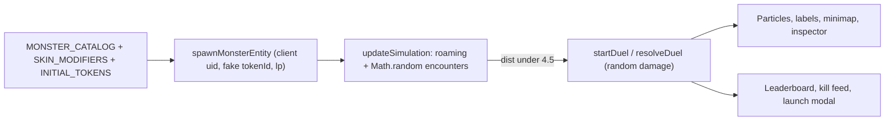
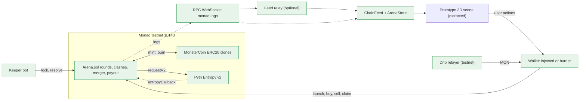
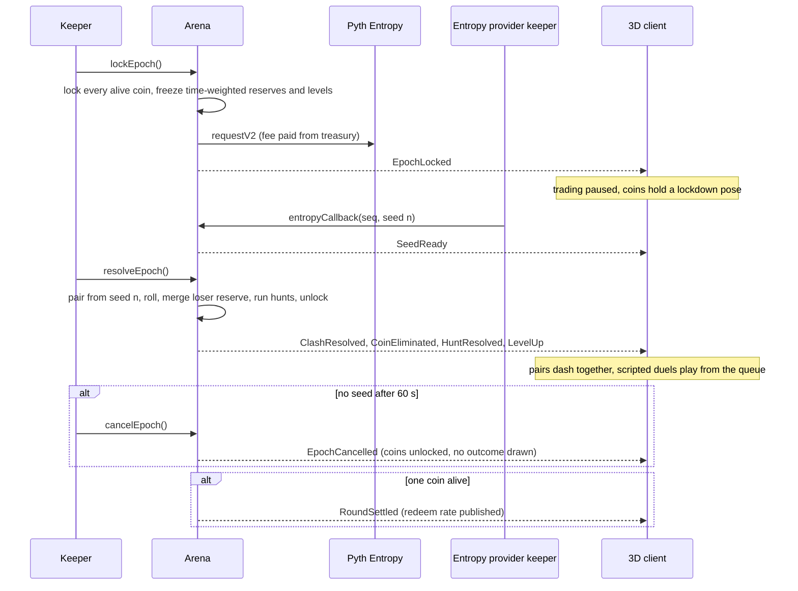
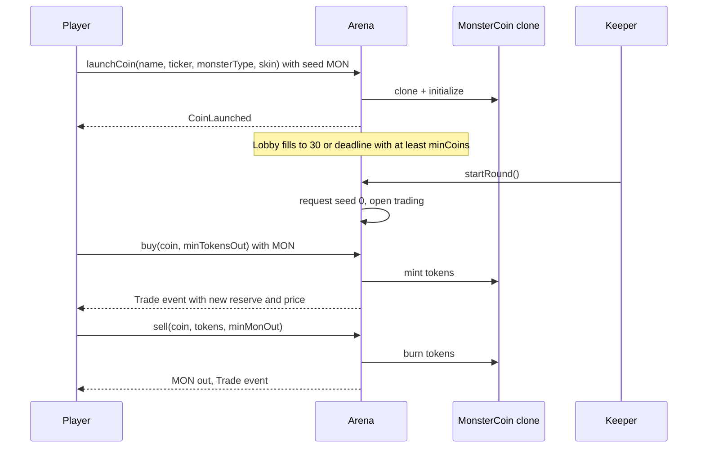
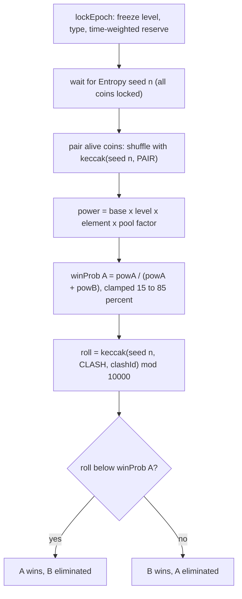
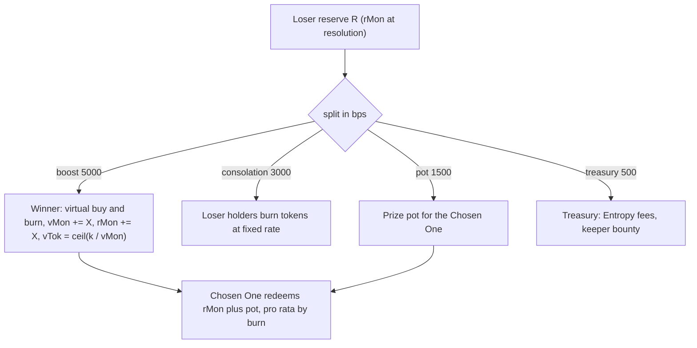
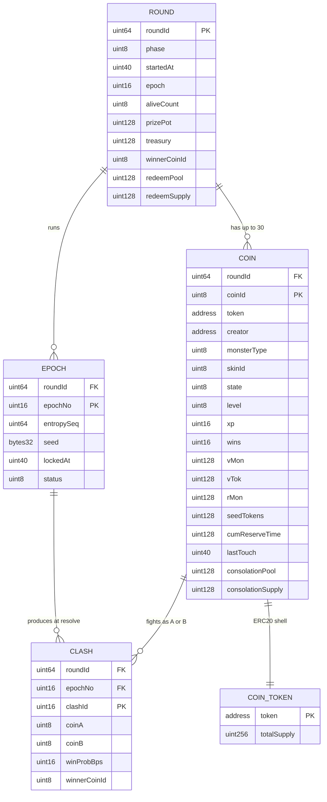
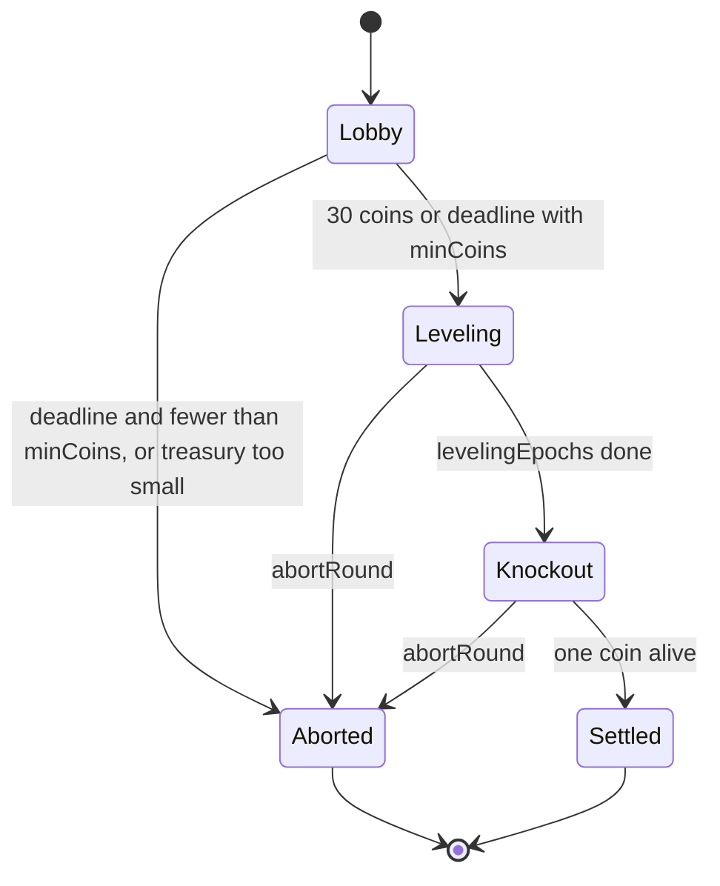
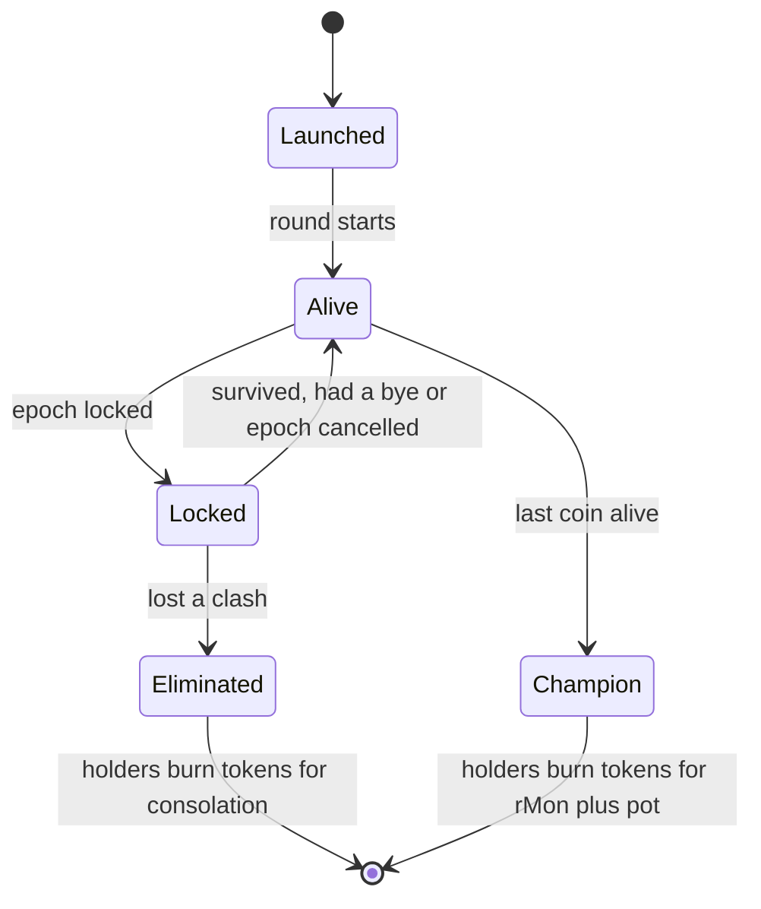

# Monster Arena on Monad: architecture

Back to the plan: [../2026-10-19-monad-monster-arena-onchain.md](../2026-10-19-monad-monster-arena-onchain.md) · research: [research.md](./research.md)

All `file:line` references point at `monster_arena_3d_prototype (1).html` in the project root (4,184 lines, one inline
`<script>` from line 567). The project is not a git repo and has no `package.json`, no contracts and no tests yet, so the
"current architecture" is the prototype and nothing else.

## Current architecture

The prototype is a fully client-side simulation: Three.js r128 plus Tailwind from CDNs (lines 7-9), no backend, no chain.

| Concern | Where | Behaviour today |
|---|---|---|
| Catalog | `MONSTER_CATALOG` :578, `SKIN_MODIFIERS` :662 | 5 archetypes and 5 skins. Visual fields only (colors, `scaleUnits`, `locomotion`, `attackName`); the only gameplay field is `element`. |
| Token roster | `INITIAL_TOKENS` :671 (12 rows), `createRandomTokenConfig` :2838 | Fake `{ticker,name,monsterId,lp,skinId}`; random fill after the 12th. `lp` is "Simulated USD". |
| Population | `syncPopulation(60)` :4131, scale buttons 60/200/350/500 | 60 monsters, not the 30 of the architecture diagram. |
| Entity | `spawnMonsterEntity` :2775-2836 | Client-only `uid`, fake `tokenId`, `x,z,vx,vz`, `hp=100`, `wins`, `rank`; position from `findSafeSpawnPosition`. |
| Encounters | `updateSimulation` :3505-3515 | `Math.random() < 0.08` and `dist < 4.5` starts a duel, max 8 concurrent. Purely visual randomness. |
| Duel | `startDuel` :3098, strike loop :3400-3417, `resolveDuel` :3123 | Alternating strikes every 0.45 s, damage `18 + random*22`, first to 0 HP loses. **Winner is random and `lp` is never transferred**: `resolveDuel` only changes `wins` and plays the consume animation. |
| Consume FX | `spawnConsumptionParticleStream` :3060, `spawnVictoryCelebrationBurst` :2892 | Particles flow loser to winner; reusable as the "auto-buy boost" visual. |
| Ranking | `recalculateLeaderboard` :3691 | Sorts by `lp`, top 3 get a crown. |
| Kill feed | `addKillFeedEntry` :3730 | Winner CONSUMED loser, shows loser's simulated LP. |
| Launch | form submit :4112 | Spawns a monster near the center with a victory burst; `lp` 1,000-250,000 input. |
| Respawn | `autoRespawn` :2652, :3439 | A consumed monster is replaced by a random one. Must go away on chain (elimination is permanent within a round). |
| World | `WORLD_RADIUS` :689, `BIOMES` :690, `getBiomeAt` :697 | 4 biomes + central ruin; biome only affects the text narrative, not gameplay. |

_Caption: everything, including who wins and the "LP" numbers, is simulated in the browser tab. The chain integration replaces the red edges (spawn data, encounter trigger, duel outcome, leaderboard source), not the scene._

**Scale tier: MVP.** Signal: pre-launch hackathon build, expected tens of concurrent spectators, one active round. The binding
constraints are not DAU. They are (a) public RPC limits (25 rps on the QuickNode public node, `eth_getLogs` range 100 blocks) and
(b) the 30M per-tx gas cap on the resolve transaction. Scale-ready means a stateless relay and keeper, not new infrastructure.

## Touchpoints

| File / module | Today | Change |
|---|---|---|
| `monster_arena_3d_prototype (1).html` :567-4183 (script) | One inline script | Extract **verbatim** to `web/public/arena/arena3d.js` (no rewrite). Add a small `ArenaBridge` at the end (see plan). Keep Tailwind CDN and r128 globals. |
| `INITIAL_TOKENS` :671, `createRandomTokenConfig` :2838, `syncPopulation` :2858 | Fake roster | Remove from chain mode. Population comes from `ArenaStore.hydrate(snapshot)`. Keep as dev fixtures behind `?sim=1`. |
| `spawnMonsterEntity` :2775 | Creates entity with random ids | Accept `{coinId, token, ...}` from the store; `uid = "c" + coinId`; `tokenId = token address`. Position = `hash(roundId, coinId)` so every client starts from the same layout. |
| `updateSimulation` encounter block :3505-3515 | Random encounters | Disabled in chain mode. Replaced by `onEpochLocked` (all coins hold a "lockdown" pose, trading paused) and `onClashResolved` (pair dashes to a midpoint, then the scripted duel). Roaming stays cosmetic. |
| Duel strike loop :3400-3417, `startDuel` :3098, `resolveDuel` :3123 | Random damage decides | Scripted replay seeded by `clashId`; the on-chain winner is forced to be the survivor. `resolveDuel` is called by `onClashResolved`, not by HP. Duels from one epoch are queued so at most 8 play at once (the prototype's own readability cap). |
| `spawnConsumptionParticleStream` :3060 | Loser to winner particles | Reuse; add a "boost" aura and floating text `+X MON` on the winner. |
| `recalculateLeaderboard` :3691, `addKillFeedEntry` :3730 | Sort by `lp` | Sort by `reserveMon`; kill feed fed by `ClashResolved` events with real amounts. |
| Launch form :4112 | Local spawn | Calls `Arena.launchCoin` through the wallet; only enabled in Lobby. |
| Debug controls (trigger duel, scale test, auto-respawn) | Always visible | Hidden unless `?sim=1`. |
| (new) `contracts/` | none | Foundry project: `Arena.sol`, `MonsterCoin.sol`, `CurveMath.sol`, `CombatMath.sol`, seed adapters. |
| (new) `keeper/` | none | TypeScript keeper, faucet-drip and feed relay (one stateless Node service). |
| (new) `shared/catalog.json` | none | Single source for `monsterId` string, enum index, element, base stats, skin index. Consumed by tests, keeper and client. |

## Proposed architecture

_Caption: green = new. The 3D scene is the only existing box, and it only gains an input (`ArenaStore`) and an output (wallet actions). The relay is optional: the client can read the WebSocket directly, the relay only hides the API key and fans out to many viewers._

Design choices that shape the picture:

1. **Ledger-in-Arena, ERC20 shells.** All MON for all coins sits in one `Arena` contract with a per-coin ledger. Each coin is still a real ERC20 (ERC-1167 clone, mint/burn only by Arena) so wallets and explorers show 30 coins. A merger is then a ledger move with no external calls.
2. **Global epoch lock.** When an epoch starts (`lockEpoch`), every alive coin stops trading (buy, sell, transfer) until `resolveEpoch` finishes. Pairing is computed inside the resolve transaction from the new seed, so nobody can know who fights whom, or who wins, while any coin is still tradable. This removes both the sandwich surface around the merger and the "bracket is public a whole epoch early" problem found in the red-team review.
3. **One Entropy seed per epoch**, requested in the same transaction that locks the coins. The callback stores the seed only; resolution is a separate permissionless call that pairs, rolls, merges, runs hunts and unlocks.
4. **No indexer on the hot path.** The client reads logs from `monadLogs` and a Multicall3 snapshot. An indexer (Envio) is P2 for history and leaderboards.

## Main flow

_Caption: trading is paused only between `EpochLocked` and the resolve transaction (the Entropy latency of about 2-4 s plus one or two blocks). Nobody learns pairs or winners while any coin can still trade. Failure branch: a late seed cancels the epoch and unlocks coins; no weak fallback randomness is ever used for value._

**Lobby to live, and trading:**

_Caption: trading is closed in Lobby (no sniping advantage at launch) and opens for everyone at `startRound`. `minTokensOut` and `minMonOut` are mandatory slippage guards._

## Clash decision and merger

_Caption: inputs to the odds are frozen before the seed exists, and pairing plus the roll happen in the same transaction. Every random draw is domain-tagged (PAIR, CLASH, HUNT) so ids can never collide across draw types._

_Caption: the "auto-buy" of the diagram is a virtual buy-and-burn on the winner's own curve: MON enters the reserve and the same amount of curve-side tokens is removed with `k` preserved, which is exactly what a real swap-then-burn would leave behind, but with no external swap and nothing to sandwich. Injecting MON without shrinking `vTok` is a bug (red-team finding F1: a 1-wei sell would collect the whole bonus). Default split is a tunable assumption; see Open question 1 in the plan._

## Data model

_Caption: logical model. Physically `COIN` is packed into 2 to 3 storage slots. `CLASH` rows exist only inside the resolve transaction and as events (the pairing is unknown before resolve, so there is nothing to store between lock and resolve). `consolationPool/Supply` and `redeemPool/Supply` are fixed once and paid as `floor(amount x pool / supply)` per burn (no live `totalSupply()` division)._

| Structure | Key | Serves |
|---|---|---|
| `rounds[roundId]` | roundId | phase checks on every call |
| `coins[roundId][coinId]` | (roundId, coinId) | buy/sell/clash; 2 to 3 packed slots; per-coin time-weighted reserve accumulator (`cumReserveTime`, `lastTouch`) updated on that coin's trades only |
| clash results | events only | history for client and keeper; no storage between lock and resolve |
| `launchedBy[roundId][address]` | (roundId, creator) | per-address launch cap (tickers are NOT unique on chain; the UI shows `TICKER #coinId` on collision) |
| `feeAccrued[roundId][coinId]` | (roundId, coinId) | trade fees are accrued per coin and swept to the pot at clash/settle, so trades never write the shared pot (hot slot) |

## Lifecycle

_Caption: round phases. `Aborted` (also reachable by anyone after repeated epoch cancels or `maxRoundSeconds`) refunds pro rata: seeds and launch fees in Lobby, reserve-share redemption once live._

_Caption: coin states. Only `Alive` coins can be traded; every alive coin is `Locked` between `lockEpoch` and `resolveEpoch`._

## Scaling out

MVP tier: nothing to add. The keeper and relay are stateless (all state is on chain; the keeper reads the epoch timer and the
relay holds only an in-memory fan-out), so two copies can run side by side. Duplicate `declareClashes`/`resolveClashes` calls
revert on state guards and cost the loser a little gas. The real fan-out limit is the RPC WebSocket: use one keyed provider
connection in the relay and serve viewers over SSE.

## Horizontal-scaling checklist

| # | Check | Result | How |
|---|---|---|---|
| 1 | Stateless app tier | OK | Keeper and relay hold no state that is not recoverable from chain; client hydrates by snapshot. |
| 2 | Session and auth | OK | No server sessions. Wallet signs every state-changing call; burner key lives only in the browser. |
| 3 | Source of truth | fixed in design | Chain owns reserves, levels, outcomes. `ArenaStore` is a cache; on any gap it re-snapshots. Positions and animation are cosmetic and explicitly not synced across viewers. |
| 4 | Concurrency | fixed in design | Two traders in one block are serialised by the EVM; curve uses mandatory `minOut` and `deadline`. The global epoch lock plus phase guards make epoch transitions mutually exclusive with trading. |
| 5 | Idempotency | fixed in design | `lockEpoch`, `resolveEpoch`, `startRound`, `cancelEpoch` are state-guarded (revert if already done); callback matched by sequence number; claims burn tokens so they cannot repeat. `resolveEpoch` itself never reverts on data (guards for zero supply or zero reserve). |
| 6 | Connections | OK | One WS to the provider in the relay; clients use SSE. Without the relay each viewer opens its own WS (fine at tens of viewers). |
| 7 | Query shape | fixed in design | `getArenaSnapshot(roundId)` returns all coins in one `eth_call`; no per-coin loops from the client. `eth_getLogs` backfill in chunks of at most 100 blocks. |
| 8 | Caching | OK | Client caches the snapshot and applies deltas keyed by (`blockId`, `logIndex`); invalidation = refetch snapshot on reconnect or `blockId` conflict. |
| 9 | Async work | OK | Entropy is already async by design; callback stores seed only; resolution is a separate call. |
| 10 | Hot keys and contention | fixed in design | No global counter written per trade (fees accrue per coin, swept at clash/settle). Monad's parallel execution still gives serial semantics, but conflicting writes reduce parallelism. |
| 11 | Rate limits and abuse | fixed in design | On chain: per-address launch cap, launch fee, permanent (non-sellable) creator seed, max buy per tx in the first N seconds after the round opens. Off chain: faucet drip is limited per address and per IP in a shared store (Redis or SQLite on one box for the hackathon). |
| 12 | Failure modes | fixed in design | See failure table below. |
| 13 | Observability | fixed in design | Every state change emits an event with `roundId`; keeper logs `epoch`, tx hash, gas used; metric: seconds from `ClashDeclared` to `ClashResolved`; alert if above 90 s. |
| 14 | Data growth | OK | Per-round storage; clashes deleted after resolve; events are history. New round = new ids, old rounds stay readable. |
| 15 | Rollout | fixed in design | Testnet first, `Config` immutable per round, new rounds can use new parameters; contracts redeployed (testnet is reset anyway); mainnet only after an external review. |

## Failure modes

| Failure | Effect | Handling |
|---|---|---|
| Entropy callback late or never | All coins locked; round stalls | `cancelEpoch()` is allowed only after 60 s AND only while no seed has arrived; it unlocks and discards the epoch, the next `lockEpoch` requests a fresh seed; stale callbacks ignored by sequence number. Anyone can call `revealWithCallback` to re-run delivery. After 3 cancels in a row, or `maxRoundSeconds`, anyone can `abortRound()` for pro-rata refunds. |
| Callback reverts | Provider keeper cannot deliver | Callback only stores the seed and emits; no external calls, no loops. |
| Entropy fee spike (up to 10 MON) | Treasury cannot pay | `startRound` requires treasury to cover all planned epochs at `maxEntropyFee`; `fundTreasury()` is open; `lockEpoch` reverts with a clear error if the fee exceeds `maxEntropyFee`; keeper alerts. |
| Provider re-rolls (inserts dummy requests, or withholds and forces cancels) | Biased or delayed outcomes | Accepted on testnet (play-money). Mainnet gate: caller-supplied commit for the user contribution revealed at resolve, bond forfeited on non-reveal, cancel cap. See plan, threat table T3. |
| Keeper down | No epochs | Functions are permissionless with a bounty paid at resolve (never at cancel); second keeper or any user can advance. Keeper EOAs need capital for the 10 MON reserve plus gas. |
| `resolveEpoch` gas too high | Tx fails | Cap `clashesPerEpoch` (6 demo, 4 standard); resolve takes `maxClashes` and can run in batches; gas is charged on the limit, so the keeper sets `estimateGas x 1.15` (a 9M-gas limit costs about 0.9 MON at the 100 gwei floor). |
| RPC WebSocket drops | Client desync | Re-subscribe first, buffer, re-snapshot at `safe`, backfill logs in chunks of at most 100 blocks, drop buffered blocks whose `blockId` lost to a finalized sibling. |
| Public RPC rate limit at demo | Feed stutters | Keyed provider, relay with one upstream connection, fallback to polling `eth_getLogs` every second. |
| Faucet empty | New judges cannot trade | Pre-funded house wallets, drip relayer with per-address cap, QR to the official faucet. |
| Stuck round (never reaches one coin) | Funds locked | `emergencyRefund` after `maxRoundSeconds`: holders redeem pro rata against reserves; pot split by reserve share. |
| Contract bug found mid-demo | Wrong payouts | Round-scoped `Config`; per-round pause that only stops new launches and epochs, never withdraws; deploy a fixed version for the next round. |
