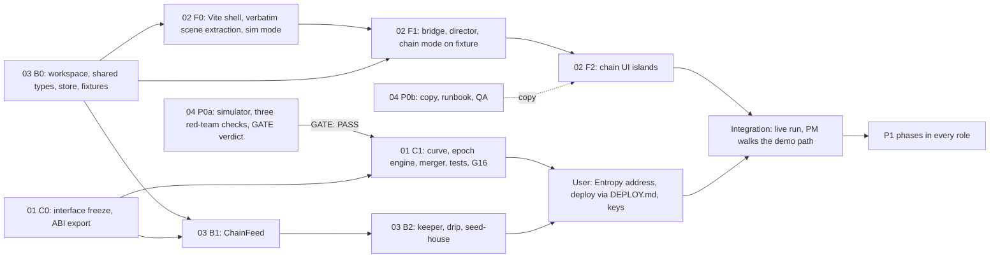

# 00 — Overview: Monster Arena on Monad

Revision 2, 2026-10-19. Reconciled to the user's final decisions (see `docs/research/05-synthesis.md`, section "User decisions of record") and to the brainstorm plan, which wins every conflict. No implementer has been dispatched; dispatch waits for the user's own "yes" at the PM gate.

## The product in one paragraph

A real-time on-chain battle royale for coins, for fun (no competition, no deadline). Up to 30 coins per round live in a shared 3D arena (the existing Three.js prototype). Each coin is a real ERC-20 clone with its own virtual-reserve bonding curve, all held in one `Arena` contract on Monad testnet. Every epoch the arena locks all alive coins and requests one randomness seed; from that seed it pairs coins, rolls the clashes, merges each loser into its winner (a virtual buy-and-burn boost on the winner's curve; part of the loser's value becomes a consolation for its holders, part feeds a prize pot, part the treasury), runs PvE hunts for xp, and unlocks. The last coin standing is the Chosen One and is redeem-only at `(reserve + pot) / supply`. The 3D client replays confirmed chain events and never decides an outcome. The four stages come from `docs/download (1).png`: Arena Spawn, PvE Leveling, Liquidity Merger, The Chosen One.

## Role map

| # | Role | Handoff | Owns | Agent type at dispatch |
|---|---|---|---|---|
| 01 | Smart contracts | `01-smart-contracts.md` | `contracts/**`, `deployments/**` | general-purpose |
| 02 | Frontend and 3D integration | `02-frontend-3d.md` | `web/**` | `me:frontend` |
| 03 | Backend: workspace, shared ChainFeed, keeper, faucet | `03-backend-keeper-relay.md` | root workspace files, `keeper/**`, `shared/**` | general-purpose |
| 04 | Product, economy and demo | `04-product-economy-demo.md` | `README.md`, `docs/pitch/**`, `docs/demo/**`, `sim/**` | general-purpose |

Everything else belongs to the PM: `docs/research/**`, `docs/handoffs/**`. `docs/brainstorm/**` and `docs/arch.md` belong to the brainstorm agent and are read-only for every role. The prototype HTML and the diagram PNG are read-only for everyone and must stay byte-identical.

### Ownership rules

- Every path belongs to exactly one role. A role that needs a dependency or a change outside its paths asks the PM, who routes it to the owner.
- Shared files: the workspace root (`package.json`, `pnpm-workspace.yaml`, `pnpm-lock.yaml`, `tsconfig.base.json`, `.gitignore`, `.env.example`, `.nvmrc`) belongs to role 03. Each package's own `package.json` belongs to the package's owner.
- `contracts.md` belongs to the PM. A role needing a change reports it; the PM edits the file and tells every consumer.
- Lockfile hygiene: role 03 runs the single pass that installs `keeper`, `shared` and root dependencies in its Phase B0, before role 02 installs `web`. After that each role installs only its own package with `pnpm install --filter <pkg>`. Role 01 uses Foundry with `forge install --no-git` and does not touch pnpm. Role 04's `sim/` has no dependencies.
- There is no git repository. No role runs `git`.

## Hard limits for every implementer (user decision)

- No deploy and no private keys anywhere. Deployment is a user step through `contracts/DEPLOY.md` with a Foundry keystore; keeper, drip and seeder keys are environment variables the user supplies. Local rehearsals use anvil's public dev accounts only. No agent sends a transaction to any real network.
- No global installs. No git. No Monkies tasks. Do not edit the prototype HTML or the PNG.
- The user's credentials from the global instruction files never go into any file or prompt.
- Stop and report at the user step (testnet deploy plus keys) and at integration.

## Dependency graph and dispatch order

Dispatch order after the user's own "yes":

1. **Wave 1, in parallel (disjoint paths):** 03 Phase B0 (short; unblocks everyone), 04 Phases P0a and P0b, 01 Phase C0.
2. **When 03 reports B0 done:** dispatch 02 Phase F0 and F1 against the fixture replay. 02 does not wait for contracts.
3. **When 01 reports C0 done (ABI frozen):** 03 continues with B1 (ChainFeed) and B2 (keeper, faucet, house seeding) against the ABI and a local anvil deploy.
4. **Economy gate:** 01 starts Phase C1 only after 04 reports `GATE: PASS` in `docs/pitch/economy-report.md` and the PM relays the final parameters. On `GATE: FAIL` the PM stops and escalates to the user (the brainstorm's fallback is stake pools).
5. **Checkpoint G16 inside Phase C1:** if invariants 1-5 and tests T1, T2, T4, T6, T10, T15 are not green after about 16 agent-hours or two fix cycles, 01 reports; the PM and the user decide on the stake-pool fallback.
6. **02 Phase F2** (chain UI islands) after F1 and once `docs/pitch/copy.md` exists (it may start with the Appendix A strings).
7. **User step (stop and report):** the user supplies the Entropy contract and provider addresses, runs `contracts/DEPLOY.md` with a funded keystore, supplies keeper, drip and seeder keys as environment variables, and optionally a keyed RPC. The PM reports to the user and waits.
8. **Integration (stop and report):** 03 seeds the lobby and starts the keeper against the testnet; 02 switches from fixture to live; the PM walks the demo path with role 04's QA checklist and the `data-testid` map, then reports.
9. Only after every P0 on the demo path is green does any role start P1. No role starts P1 while any P0 on the demo path is red. P2 only if time remains.

Review at the end of every phase: the PM reads the files and runs the role's own `typecheck`, `lint`, `build` and `test` (and `forge test` for 01, `node sim/run.mjs` for 04); a failed criterion is re-dispatched with the specific failure and the fix. Frontend can be dispatched per phase (F0-F1, F2, F3) with the same handoff and a "do phase X" instruction.

## The demo path (this defines P0)

Setting: a fresh round on Monad testnet created with the demo preset (30 coins max, 8 minimum, lobby 120 s, 3 leveling epochs of 20 s, then knockout epochs; about 3.5 minutes), the lobby seeded with house coins (labelled "House"), the keeper running, the treasury funded for all planned epochs, a second browser window for the spectator, explorer tabs open. Disclosed on screen: testnet play-money, demo preset timers, house coins.

| # | Click or action | On screen | Real |
|---|---|---|---|
| 1 | Open the app as a spectator (no wallet) | Arena with the lobby coins; `coin-counter` reads N / 30; `lobby-timer` counting down; stage rail on 1 (Arena Spawn); `Monad Testnet` badge and the testnet play-money banner; rules card with the 50/30/15/5 split; status chip `Live` with a block number | `ChainFeed` snapshot and `monadLogs`; contract address on screen |
| 2 | `Connect Wallet`, then `Use burner` (or an injected wallet) | Burner created; balance appears after the drip | Real MON drip transaction |
| 3 | `Launch Coin`: name, ticker, monster, skin, seed in MON, `Launch` | Toast pending then confirmed; a new monster pops into the arena only after `CoinLaunched` is Finalized; counter N+1 / 30 | `launchCoin`: ERC-20 clone and its own curve created, creator seed held by the Arena |
| 4 | Lobby ends (timer or full) and the keeper starts the round | `RoundStarted`: camera fits the world; stage rail moves to 2 (PvE Leveling); trading opens | `startRound` |
| 5 | Click a coin on the map or the leaderboard, open the inspector, enter an amount, `Buy` | The pool reserve (`rMon`) moves, the leaderboard re-ranks, the toast links to the explorer | `buy` on the curve; `Trade` event with post-trade reserves |
| 6 | Watch a leveling epoch: `EpochLocked` | `LOCKDOWN` banner with countdown; buying is refused with a `Locked` reason; public power ratings shown; every coin holds a pose | `lockEpoch` freezes all alive coins and requests the seed |
| 7 | `SeedReady`, then `EpochResolved` | Wild NPCs appear beside coins for a 1.2 s hunt; success shows `+xp`; leveling coins gain levels; trading unlocks | One Entropy seed; hunts rolled from it; `HuntResolved`, `LevelUp` |
| 8 | Knockout epoch: lockdown, seed, then `ClashResolved` and `Boosted` | Pairs dash to a midpoint, scripted duel that ends on the chain's winner; the loser dissolves; a boost stream and aura flow into the winner with floating `+X MON boost`; a feed row with boost, consolation, pot, treasury and an explorer link; stage rail moves to 3 (Liquidity Merger); a coin may get a bye | `resolveEpoch`: pairing from the new seed, rolls, virtual buy-and-burn boost, consolation fixed |
| 9 | As the burner wallet (which bought the coin that was just eliminated) click `Claim consolation` | Button enables at Finalized; toast confirmed; balance rises | `claimConsolation` at the fixed rate |
| 10 | Epochs continue until one coin is left | Final merge; `RoundSettled`; stage rail 4 (The Chosen One); crown finale; the Chosen One screen shows the published redeem rate `(rMon + pot) / supply` read from the chain; `Redeem` for holders | `RoundSettled`, `redeem` |

PvE (steps 6-7) and the 3D visuals are part of P0; P1 adds `Lv N` badges and xp bar, odds bar, pool vessels, sell, and `consolationMode = SpreadSurvivors` visuals. If the randomness provider stalls the demo shows `EpochCancelled` ("Arena stabilised") after 60 s and three cancels allow `abortRound` with refunds; the runbook rehearses this. Fallbacks: `?replay=fixture` plays the same path with no chain; `?sim=1` is the original prototype simulation.

## Priorities and gates

- **P0**: on the demo path; must work end to end. **P1**: makes the product credible. **P2**: only if time remains. There is no deadline: P0, then P1, in phases.
- A phase is done when its acceptance criteria in the role file pass, verified by the PM by running the project's own `typecheck`, `lint`, `build` and `test` commands and reading the files.
- Findings that overturn a research claim go back into `docs/research/` and `05-synthesis.md` before any re-dispatch.

## Technology decisions (reasoning in `docs/research/05-synthesis.md`)

| Layer | Choice | Why | Rejected |
|---|---|---|---|
| Network | Monad testnet 10143 only | 300 ms blocks, finality about 0.6 s, free MON | Mainnet |
| Money model | One `Arena`, ERC-1167 `MonsterCoin` clones, virtual-reserve curve per coin, permanent creator seed | The loser's pool really moves, atomically; red-team fixes built in | Real-reserve CPMM only, nad.fun or Uniswap pools, plain reserve injection |
| Merger | Virtual buy-and-burn boost; split 50/30/15/5 as configuration; consolation claims at a fixed rate; spread to survivors is a switch (default off); Chosen One redeem-only | Diagram stage 3; no bearer bonus; no race to exit | 70/20/10, snapshot airdrop |
| Fairness | Global epoch lock, one seed per epoch, pairing and rolls at resolve, odds public and frozen, `ISeedSource` with Entropy (real) and Mock (tests only) | Nothing exploitable is tradable when information appears | Per-clash freeze, keeper-picked pairs, blockhash |
| Economy | Simulation gate before Solidity; EV per MON 0.87-0.97 over 0.25x-5x | Pre-mortem 1 | Tuning after the fact |
| Contracts toolchain | Foundry, solc 0.8.31 osaka (no via_ir), OZ 5.6.1, Solady, Entropy SDK | Fuzz and invariants; installed | Hardhat |
| Backend | `keeper/` (viem, Hono): loop, drip, house seeding; optional SSE relay (P1); no indexer | Tiny event volume | Ponder, Envio, Goldsky |
| Feed | `shared/` `ChainFeed` over raw `monadLogs` plus Multicall3 snapshot; commit-state gating | `blockId` and `commitState` are only on `monadLogs` | Polling the public RPC |
| Frontend | Vite, extracted vanilla scene (three 0.128.0), React islands for new UI, Tailwind v3 built | Keeps the look; no hydration work | Next.js, three upgrade, Tailwind v4 |
| Wallet | viem, EIP-6963 injected, testnet burner with drip | Zero-popup demo | wagmi, RainbowKit, Privy (P2) |
| Hosting | Railway (keeper), static host (web) | Long-lived process for the keeper | Vercel functions for the keeper |

## Design-system summary (full inventory: `docs/research/01-design-system.md`, embedded verbatim in `02-frontend-3d.md` Appendix A)

| Token | Value |
|---|---|
| Page and panel | `#080b14` obsidian page; glass panel `rgba(13,18,32,0.84)` with `blur(14px)`, border `rgba(148,163,184,0.18)`, shadow `0 12px 32px -8px rgba(0,0,0,0.65), inset 0 1px 0 0 rgba(255,255,255,0.08)` |
| Accent semantics | amber = brand, winner, primary action; sky `#38bdf8` = selection, boost, pending; emerald `#34d399` = value, holders, confirmed; rose = loss, damage, failed; purple = consumption; slate ramp for neutrals |
| Fonts | Cinzel (brand title, modal title, stage banners, Chosen One), Plus Jakarta Sans (body), JetBrains Mono (every number, ticker, address) |
| Type scale | 9, 10, 11 px dominate; `text-xs` for controls; `text-sm` for stats |
| Radii and spacing | `rounded-lg` 8, `rounded-xl` 12, `rounded-2xl` 16; gutters 12 px, stack gap 10 px |
| Zones | top bar, left filters (w-60), right leaderboard and feed (w-72), bottom-left inspector (350-380 px), bottom-right camera and minimap (144 px); z: canvas 0, world labels 5, HUD 20, modal 50 |
| Scene | background `0x0b1325`, camera FOV 35 at (0,178,202) looking at (0,0,10), world radius 135, four biomes (Ice N, Dark E, Lava S, Forest W) plus a central citadel; Three.js r128 |
| Monsters | fire_dragon `#ef4444`, ice_wolf `#38bdf8`, earth_golem `#22c55e`, electric_fox `#facc15`, dark_spirit `#a855f7` (badge colours) |
| Hazards | no `focus-visible`, no `disabled`, no reduced-motion, global `user-select: none`, undefined `animate-fade-in`, static "Just now"; all fixed during the extraction |

## Shared conventions

- English everywhere: identifiers, strings, documentation, commit messages, replies. No Indonesian string may remain in the product.
- No comments in code (single exception: one `// TEMPORARY — <what it is>; delete with <what to remove>` line on explicitly temporary scaffolding; and the SPDX line at the top of `.sol` files). The extracted prototype code has its comments stripped.
- TypeScript strict for all `.ts` and `.tsx`: no `any`, no `@ts-ignore`, no `@ts-nocheck`, no non-null assertion used to silence a real nullable. The extracted scene `.js` is excluded from checking by configuration.
- No new dependency without asking; the handoffs list the pre-approved ones.
- Use the installed skills and MCP servers named in each role's `Tools` section before writing the code they cover. Never call `monad-docs` `submit_feedback`.
- Every animation respects `prefers-reduced-motion`.
- Never read, write or echo `.env*` files or secrets. `.env.example` has names only. No role creates, imports or prints private keys.
- Never run `git commit`, `git push` or destructive git commands; never `git add -A` or `git add .`.
- Wording: "arena", "clash", "merge", "boost", "consolation", "claim", "redeem", "launch". Never "bet", "wager", "payout", "yield". A permanent testnet play-money label; house coins labelled.
- Builds go through the machine's shims (4 cores, 4 GB heap); use plain `pnpm` and `forge` commands.
- Money is `bigint` in code and decimal strings in JSON; floats exist only for display.

## Index of `docs/research/` and `docs/brainstorm/`, and who reads what

| File | What it concludes | 01 contracts | 02 frontend | 03 backend | 04 product |
|---|---|---|---|---|---|
| `brainstorm/...onchain.md` | The authoritative design: money model, curve, combat, config, interface, events, threat model T1-T15, economy table, event-to-animation, epics, prompts | full | Spec 2-4, E6-E7, Prompt C | Spec 3-5, Prompt B | full |
| `brainstorm/.../architecture.md` | Diagrams: epoch sequence, merger, ER, lifecycles, failure modes | full | Touchpoints, current architecture | failure modes | merger flow, lifecycles |
| `brainstorm/.../research.md` | R1-R44 with sources | R5-R20, R32-R36 | R23-R25 | R2-R5, R23-R26 | R30-R37 |
| `prd-inferred.md` | Initial assumptions (superseded where the decisions of record differ) | skim | skim | skim | skim |
| `01-design-system.md` | Tokens, zones, class strings, 15 Indonesian strings, 9 defects, proposals P1-P10 | field limits | full (also embedded) | - | string slots |
| `02-tech-stack.md` | Monad facts, Foundry config, wallet and burner, platform limits (its pool, randomness, Next.js and indexer sections are superseded) | F1, F2, D2, D10 | F7, D8, D10 | F1, F5, D5, D10 | - |
| `03-domain.md` | Mainnet 143 and testnet 10143 live; comparables; guardrails; attack list (hackathon material informational only) | guardrails, attacks | guardrails shown in UI | guardrails for keeper | Findings 3, 4, 6, guardrails |
| `04-repo-audit.md` | Code map, 25 seams, hazards, ChainDrivenMode (its module split is superseded) | - | Findings 1, 2, 4, 5, 7, 8 | event pacing | Implications |
| `05-synthesis.md` | Decisions, contradictions, fixed stack, unverified assumptions | full | full | full | full |
| `06-tooling.md` | Installed skills and MCP, rejected, needs the user | Tools section | Tools section | Tools section | Tools section |

## Decisions of record and what the user still has to do

Decided (user, final): no competition; testnet only; the brainstorm mechanics; Vite plus the extracted scene; injected plus burner wallet; no indexer in v1; four roles; the epoch-model demo path. Open items are user steps, not decisions:

1. The Entropy contract and provider addresses (supplied at deploy time).
2. A funded deployer keystore and running `contracts/DEPLOY.md`.
3. Keeper, drip and seeder keys as environment variables (never in the repo); about 25 MON for the keeper EOA; optionally a keyed RPC and `HOUSE_MNEMONIC`.
4. Approving the four project MCP servers in a new Claude Code session; optionally a deny rule for `mcp__monad-docs__submit_feedback`.
5. Reviewing the economy report's "Decisions for the user" table when it exists.

## Handoff protocol

- A role that needs a change to `contracts.md` or a path it does not own reports back to the PM instead of diverging.
- When a role reports a research finding was wrong, the PM corrects the research file and the synthesis before re-dispatching.
- Review: the PM reads the delivered files, runs the project's own `typecheck`, `lint`, `build` and `test`, and checks every acceptance criterion; failures are re-dispatched with the specific failure and the fix.
